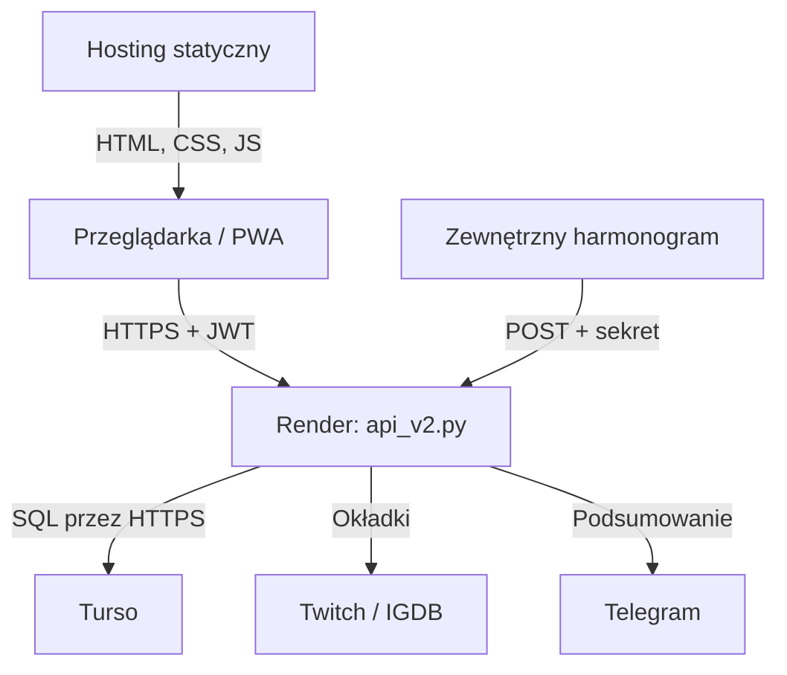

# Preorder Hub - pełna dokumentacja projektu

**Wydanie frontendu 3.1 | backend api_v2.py / Turso HTTPS | 24 listopada 2026**

Dokument opisuje kod, obsługę, konfigurację, wdrożenie i utrzymanie Preorder Hub. Ma służyć właścicielowi projektu i kolejnemu programiście bez dostępu do wcześniejszej rozmowy. Priorytet instalacji PWA: telefony i tablety z Androidem; iOS oraz komputery są opisane dodatkowo.

## 1. Od tego zacznij

### 1.1. Którą wersję uznajemy za właściwą

Właściwy nowy frontend znajduje się w katalogu `v3/`. Właściwy analizowany backend to `api_v2.py` zawierający klasę `TursoHTTPClient` i komunikację z bazą przez HTTPS. Do poprawki instalacji PWA wdraża się **cały katalog `v3/`**, łącznie z `assets/`. Nie zmienia się przy tej operacji nazwy backendu, zmiennych Render ani struktury bazy.

Komenda uruchomienia właściwego backendu na natywnej usłudze Python w Render:

```bash
uvicorn api_v2:app --host 0.0.0.0 --port $PORT
```

`api_v2` oznacza plik `api_v2.py`, a `app` obiekt FastAPI wewnątrz niego. Nazwa pliku i moduł w komendzie muszą się zgadzać. W tym wydaniu nie ma potrzeby przemianowania pliku na `api.py` lub `main.py`.

W repozytorium pozostał historyczny `api.py`, a dołączony Dockerfile nadal uruchamia `api:app`. Stare `README_preorder.md` opisuje ponadto nieaktualny wariant WebSocket. Dla wersji HTTPS obowiązuje niniejsza dokumentacja. Obecność obu plików nie oznacza, że oba działają jednocześnie - rozstrzyga komenda uruchamianego procesu.

### 1.2. Co znajduje się w przekazanych plikach

| Plik lub katalog | Do czego służy |
| --- | --- |
| `PreorderHub_v3_frontend.zip` | Paczka do aktualizacji interfejsu: kompletny `v3/` i krótka instrukcja. Zawiera poprawkę instalacji PWA. |
| `PreorderHub_Dokumentacja.pdf` | Wersja do czytania i wydruku, ze spisem treści i numerami stron. |
| `PreorderHub_Dokumentacja.md` | Ta sama dokumentacja jako edytowalny tekst do repozytorium. |
| `PreorderHub_archiwum_2026-11-24.zip` | Zestaw do zachowania: nowy frontend, przekazana kopia repozytorium, dokumentacja, SQL crona, szablon konfiguracji i testy poprawki. |
| `frontend/v3/` w pełnym archiwum | To ten katalog kopiujesz do swojego aktualnego repozytorium. |
| `snapshot_repo/PreorderGames-main/` w pełnym archiwum | Źródła odzyskane z dostarczonego ZIP, z historycznymi plikami. To punkt odniesienia, nie potwierdzona najnowsza kopia GitHuba. |
| `sql/weekly_summary.sql` w pełnym archiwum | Osobno odzyskana migracja tabeli crona. Nie tworzy czterech głównych tabel. |
| `konfiguracja/backend.env.example` | Nazwy i opis zmiennych, bez prawdziwych wartości sekretów. |
| `testy/pwa_logic.test.cjs` | Powtarzalne testy zachowania instalatora i reguł cache, uruchamiane w Node.js. |
| `dokumentacja/SOURCE_MANIFEST.json` | Wykaz plików i skróty SHA-256 umożliwiające rozpoznanie tego wydania. |

Archiwum projektu zachowuje kod dostępny w tej pracy. Nie zawiera produkcyjnej bazy, prawdziwych sekretów, konfiguracji kont usług ani historii commitów Git. Te elementy trzeba zachować osobno, zgodnie z procedurą kopii zapasowej w rozdziale 6.

### 1.3. Co potwierdzono, a czego nie

Podstawą dokumentacji są dwie odzyskane paczki: frontend v3 i przekazany ZIP repozytorium oraz osobny `weekly_summary.sql`. Poprawkę PWA przygotowano lokalnie. Nie odczytano panelu Render, panelu hostingu, rzeczywistego schematu Turso ani ustawień schedulera. Wskazane domeny pochodzą z konfiguracji kodu i wcześniejszych logów; nie stanowią raportu dostępności produkcji.

Sprawdzono kod, składnię JavaScript, manifest, strukturę HTML, rozmiary ikon, listę plików cache i testy logiczne poprawki. Nie wykonano instalacji na fizycznym Androidzie, a środowisko przygotowania nie pozwoliło uruchomić Chromium do nowego testu wizualnego. Szczegółowy zakres znajduje się w rozdziale 7.1. Nie wykonano deployu ani zapisów do produkcyjnych danych.

### 1.4. Instalacja na Androidzie w kilku krokach

Po wdrożeniu katalogu `v3/` otwórz w Chrome na telefonie lub tablecie **https://preorderhub.pl/v3/index.html**. Nie dopisuj `?demo=1`. Naciśnij **Zainstaluj aplikację**, a następnie **Zainstaluj teraz**, jeżeli Chrome udostępnił instalator. Alternatywą jest menu Chrome, w aktualnej instrukcji Google: **Zainstaluj i utwórz skrót → Zainstaluj**. Inne wydania mogą używać nazw **Zainstaluj aplikację** lub **Dodaj do ekranu głównego**. [S1]

Uruchom ikonę i zaloguj się dotychczasowym kontem. Instalacja dotyczy każdego urządzenia osobno. Szczegóły, zachowanie starszej ikony, wymagania HTTPS i aktualizacje opisuje rozdział 5.

## 2. Architektura: co dzieje się gdzie

### 2.1. Podział na warstwy



Frontend odpowiada za ekrany i interakcje. API sprawdza dane i uprawnienia oraz wykonuje operacje. Turso utrwala konta, gry i oferty. Usługi zewnętrzne są dodatkami: IGDB dostarcza okładki, a Telegram wiadomości wywoływane przez osobny harmonogram. PWA to sposób instalacji tego samego frontendu na urządzeniu, a nie drugi backend lub osobna baza.

| Miejsce | Co tam działa lub jest zapisane | Co zmieniasz w praktyce |
| --- | --- | --- |
| GitHub / kopia repozytorium | Pliki kodu, historię zmian zapewnia Git, jeśli repo jest sklonowane | Zmieniasz pliki i tworzysz commit; samo zapisanie pliku w rozmowie nie publikuje go |
| Hosting statyczny domeny | HTML, CSS, JS, manifest, ikony i service worker | Wdrażasz `v3/`; sposób publikacji zależy od istniejącego pipeline hostingu |
| Telefon / tablet / komputer | Uruchomiony interfejs, lokalny token sesji, cache statycznych plików PWA | Instalujesz ikonę, logujesz się, używasz formularzy |
| Render | Proces Python, FastAPI, połączenia HTTPS i zmienne środowiskowe | Wskazujesz moduł startowy, zależności i sekrety; odczytujesz logi |
| Turso | Trwałe dane aplikacji | Wykonujesz backup, inspekcję schematu i świadome migracje |
| Twitch / IGDB | Autoryzacja dostępu do katalogu gier i adresy okładek | Utrzymujesz dane aplikacji Twitch; GUI nie przechowuje tych sekretów |
| Scheduler i Telegram | Wyzwalanie endpointu i dostarczenie powiadomienia | Utrzymujesz harmonogram, sekret crona, bota i docelowy chat |

### 2.2. Znane adresy i ich znaczenie

| Adres | Rola |
| --- | --- |
| `https://github.com/dawid1110/PreorderGames` | Wskazane repozytorium projektu; analizowano dostarczony snapshot ZIP, bez ustalania bieżącego commita zdalnego |
| `https://preorderhub.pl/v3/index.html` | Docelowy nowy frontend po opublikowaniu plików |
| `https://preorderhub.pl/v3/index.html?demo=1` | Demonstracja na fikcyjnych danych, bez wywołań API |
| `https://preorder-api-pdjz.onrender.com` | Publiczny adres bazowy API wpisany w `v3/config.js` |
| `https://preorder-api-pdjz.onrender.com/ping` | Kontrola, czy odpowiada proces API; nie kontroluje bazy |
| `https://preorder-api-pdjz.onrender.com/docs` | Interaktywna dokumentacja FastAPI, jeśli działa ten backend |
| `https://preordergames.dwiad1110.workers.dev` | Dodatkowy origin dopuszczony w kodzie CORS |
| `http://localhost:5500/v3/index.html?demo=1` | Lokalny podgląd uruchamiany prostym serwerem statycznym |

Adres Turso i tokeny znajdują się w konfiguracji backendu. Przeglądarka zna adres API, ale nie potrzebuje znać adresu bazy ani jej tokenu. Nie ma dostarczonego pliku `wrangler.toml`, konfiguracji Pages lub innego kompletnego opisu pipeline hostingu. Dokładną usługę, katalog publikacji, domeny i ustawienia deployu trzeba zanotować z istniejącego panelu.

### 2.3. Przykład: od kliknięcia do zapisu

Użytkownik uzupełnia formularz gry. `readForm()` w przeglądarce sprawdza pola i buduje JSON. `saveGame()` wybiera endpoint, a `mutate()` blokuje równoległe kliknięcia i wywołuje wspólne `api()`. Żądanie trafia do Render z JWT użytkownika. FastAPI weryfikuje token, odnajduje właściciela i waliduje payload. Następnie transakcja zapisuje grę i oferty w Turso. API odpowiada JSON-em; frontend ponownie pobiera listy i przelicza widoki oraz budżet.

Nie zapisuje się lista gier do samego pliku HTML. Zmiana tytułu w `index.html` wpływa na etykietę interfejsu, a zmiana tytułu w formularzu wpływa na rekord użytkownika w bazie. Podobnie publikacja nowego CSS nie kasuje bazy, a zmiana zmiennej na Render nie zmienia automatycznie pliku `config.js` w przeglądarce.

**Podstawa rozdziału:** `v3/config.js`, `v3/app.js`, `v3/pwa.js`, `api_v2.py`, manifesty i pliki wdrożeniowe dostarczonych źródeł.

## 3. Frontend - pliki, ekrany i logika

Stan źródeł: frontend 3.1 przygotowany 24.11.2026 na podstawie pakietu `PreorderHub_v3_frontend.zip`, z uzupełnioną obsługą instalacji PWA. Rozdział opisuje aktualną logikę `v3/app.js` oraz jej podział odpowiedzialności z `v3/pwa.js`. Szczegółowe instrukcje instalacji i aktualizacji aplikacji znajdują się w osobnym rozdziale PWA. Nie jest to potwierdzenie wdrożenia paczki na produkcji. Nie wykonywano zapisów do rzeczywistego API.

### 3.1. Jaką rolę pełni frontend

Frontend to interfejs uruchamiany w przeglądarce telefonu, tabletu albo komputera. Zajmuje się logowaniem, prezentacją danych, formularzami, walidacją przed wysłaniem oraz lokalnym wyliczeniem kosztorysu. Nie łączy się bezpośrednio z Turso. Wysyła żądania HTTPS do API na Render, a dopiero API sprawdza uprawnienia i czyta lub zmienia bazę.

Nowy interfejs jest jedną aplikacją SPA: wszystkie ekrany korzystają z `v3/index.html`, a JavaScript zmienia zawartość elementu `#view`. Przejście między pulpitem, listą, kalendarzem i kolekcją nie wymaga ładowania kolejnego pliku HTML. Adres rozróżnia widoki fragmentem, np. `v3/index.html#budget`.

To aplikacja napisana w zwykłym JavaScript, HTML i CSS. W tej paczce nie ma Reacta, bundlera, `package.json` ani kroku `npm build`. Hosting musi udostępnić pliki statyczne pod poprawnymi adresami; API działa osobno. Logowanie z nowego interfejsu nadal używa dotychczasowego konta w backendzie.

**Źródła kodowe:** `v3/index.html`, `v3/config.js`, `v3/app.js`: `init`, `views`, `goto`, `render`, `api`.

### 3.2. Mapa plików

| Plik | Odpowiedzialność | Kiedy go zmieniasz |
|---|---|---|
| `v3/index.html` | Szkielet strony, metadane, odnośniki do CSS/JS/manifestu, ekran logowania, główna powłoka aplikacji, formularz gry, dialog szczegółów i potwierdzeń, menu mobilne, przyciski i dialog instalacji PWA, komunikaty | Gdy dodajesz stały element strony, pole formularza albo zmieniasz metadane |
| `v3/app.js` | Stan w pamięci, komunikacja z API, sesja, nawigacja, widoki, filtrowanie, daty, ceny, formularze, operacje dodawania/edycji/usuwania | Gdy zmieniasz działanie aplikacji lub kontrakt danych |
| `v3/style.css` | Kolory, typografia, układ, karty gier, dialogi, warianty desktop/tablet/telefon, focus i ograniczenie animacji | Gdy zmieniasz wygląd lub zachowanie układu na różnych ekranach |
| `v3/config.js` | Publiczny adres API, czas oczekiwania, waluta, język i strefa czasowa | Gdy przenosisz API, zmieniasz lokalizację lub timeout |
| `v3/pwa.js` | Przyciski instalacji, przechwycenie `beforeinstallprompt`, rozpoznawanie uruchomienia jako aplikacja, instrukcje systemowe, rejestracja service workera i informacja o aktualizacji | Gdy zmieniasz zachowanie instalacji; dokładny zakres w rozdziale PWA |
| `v3/manifest.json` | Nazwa, ikony, jawna tożsamość `id: "/"`, adres startowy `./index.html` i zakres `./` instalowanej aplikacji | Gdy zmieniasz nazwę, identyfikację albo punkt wejścia PWA |
| `v3/sw.js` | Service worker i buforowanie dozwolonych plików statycznych | Gdy zmieniasz powłokę offline, jej wersję albo zasady aktualizacji |
| `v3/assets/icon-192.png`, `icon-512.png` | Ikony z projektu, przeskalowane do 192×192 i 512×512 | Gdy zmieniasz identyfikację wizualną; trzeba zachować rzeczywiste rozmiary obrazu |
| `v3/assets/*.webp` | Ilustracje fikcyjnych gier używane przez demonstrację | Gdy zmieniasz wygląd lub przykładowe dane demo |
| `README_GUI_V3.md` | Krótsza instrukcja instalacji i podstawowych założeń | Przy każdej zmianie procesu wdrożenia |

Skrypty są ładowane z `defer` w kolejności `config.js`, `pwa.js`, `app.js`. `window.PREORDER_CONFIG` musi istnieć, gdy startuje logika aplikacji. Konfiguracja jest zamrożona przez `Object.freeze`. Nie ma tutaj sekretów Render, hasła Turso, klucza JWT, tokena Telegram ani sekretu crona.

Od wersji 3.1 wyłącznym miejscem rejestracji service workera jest `pwa.js`; końcowe `init` w `app.js` nie rejestruje go ponownie. Moduł instalacji działa niezależnie od logowania i dostępności API. Przycisk „Zainstaluj aplikację” jest dostępny zarówno przed logowaniem, jak i w powłoce zalogowanej aplikacji. Otwiera dialog z instrukcjami, a natywny przycisk instalacji pojawia się wtedy, gdy przeglądarka faktycznie przekazała `beforeinstallprompt`.

Manifest jest przewidziany do umieszczenia pod `/v3/manifest.json`: względny `scope: "./"` oznacza wtedy `/v3/`, a `start_url: "./index.html"` prowadzi do `/v3/index.html`. Jawne `id: "/"` zachowuje tożsamość wcześniejszego wydania v3, w którym `id: "./"` rozwiązywało się względem originu. Identyfikator jest niezależny od zakresu i adresu startowego: nie rozszerza działania aplikacji na całą domenę ani nie przenosi jej wejścia poza `/v3/`. Zachowanie tej samej tożsamości ogranicza ryzyko utworzenia drugiej instalacji v3 po samej aktualizacji. Dawna aplikacja startująca z `pwa-list.html` pozostaje osobną instalacją; ta konfiguracja nie migruje jej automatycznie.

Obecne wartości konfiguracji:

| Klucz | Wartość | Znaczenie |
|---|---|---|
| `apiBase` | `https://preorder-api-pdjz.onrender.com` | Baza wszystkich adresów API; frontend dopisuje np. `/login` |
| `timeoutMs` | `60000` | Żądanie przerwane po 60 sekundach bez zakończenia |
| `currency` | `PLN` | Sposób prezentacji cen |
| `locale` | `pl-PL` | Formatowanie pieniędzy, dat i porównywanie tekstu |
| `timeZone` | `Europe/Warsaw` | Ustalanie dzisiejszego dnia do odliczania premier |

Zmiana samego `currency` nie przelicza walut. API nie przechowuje osobnej waluty dla każdej oferty; wpisane kwoty są obecnie traktowane jako złote.

### 3.3. Co zastąpiło stare strony

Stara wersja miała osobne pliki dla komputerów i PWA, a w wielu z nich własny JavaScript i bezpośrednio wpisany adres API. W nowej wersji ich zadania przejęły widoki i dialogi jednej aplikacji.

| Stare wejście | Odpowiednik w nowym interfejsie |
|---|---|
| `index.html`, `pwa-index.html`, pomocnicze `bento.html` / `console.html` | Pulpit `#dashboard` |
| `list.html`, `pwa-list.html` | Preordery `#preorders` |
| `add.html`, `pwa-add.html` | Przycisk „Dodaj preorder” i dialog `#editor` |
| `edit.html`, `pwa-edit.html` | Szczegóły gry → „Edytuj”, ten sam dialog `#editor` |
| `collection.html`, `pwa-collection.html` | Kolekcja `#collection` |
| `login.html`, `register.html` | Dwa tryby formularza `#auth-form` |
| Kalendarz i kosztorys rozproszone po stronach | Pełne widoki `#calendar` i `#budget` |

Umieszczenie `v3/` obok starych plików nie zmienia automatycznie starych adresów ani wcześniej zainstalowanej aplikacji. Stare wejścia trzeba świadomie pozostawić lub przekierować po testach. Szczególnie istotny jest dawny adres startowy PWA `pwa-list.html`.

### 3.4. Stan aplikacji i nawigacja

Wszystkie dane aktualnie wyświetlane na ekranie są przechowywane w obiekcie `state` w pamięci bieżącej karty. Po przeładowaniu rzeczywiste dane są pobierane ponownie z API; nie ma lokalnej kopii listy w `localStorage`.

| Pola `state` | Znaczenie |
|---|---|
| `games`, `collection` | Listy preorderów i gier w kolekcji |
| `ready` | Czy dane zostały przynajmniej raz poprawnie załadowane |
| `busy` | Trwa pobieranie lub zapis; blokuje równoległe operacje |
| `stale` | Dane mogą być nieaktualne; interfejs ogranicza zapis |
| `error` | Bieżący komunikat błędu |
| `view` | Aktywny widok, np. `dashboard` albo `budget` |
| `search`, `platform`, `budgetFilter`, `sort`, `layout` | Aktualne ustawienia wyszukiwania i listy |
| `cal`, `selectedDay` | Miesiąc kalendarza i zaznaczony dzień |
| `authMode` | Formularz logowania albo rejestracji |
| `epoch` | Numer generacji sesji; chroni przed zastosowaniem spóźnionej odpowiedzi z poprzedniej sesji |
| `editGame`, `detailsGame` | Aktualnie edytowana lub oglądana gra |
| `demoCounter` | Lokalny licznik identyfikatorów w demonstracji |

Mapa `views` zawiera nazwy ekranów, ikony, tytuły i podtytuły. `goto` zmienia widok, zeruje wyszukiwanie, zamyka mobilne menu i aktualizuje fragment adresu. Listener `hashchange` obsługuje m.in. historię przeglądarki. Nieznany fragment adresu prowadzi do pulpitu. Dane filtrów i układ listy nie są zapisywane trwale w przeglądarce.

### 3.5. Logowanie, sesja i przechowywanie danych

Przy uruchomieniu normalnego trybu aplikacja odczytuje z `localStorage` klucze `access_token`, `username` i `user_id`. Jeśli token istnieje, pokazuje powłokę aplikacji i próbuje pobrać dane. Sam fakt istnienia tokena w przeglądarce nie potwierdza ważności sesji; rozstrzyga to API.

Logowanie wysyła `POST /login` w formacie `application/x-www-form-urlencoded`, czyli `username` i `password`. Udana odpowiedź musi zawierać niepusty `access_token` i `user_id`. Token, identyfikator i nazwa użytkownika są zapisywane w trzech wymienionych kluczach. Hasło zostaje usunięte z pola formularza. Rejestracja wysyła JSON do `POST /register`; po sukcesie wraca do logowania i nie loguje automatycznie.

Żądania chronionych endpointów otrzymują nagłówek `Authorization: Bearer <token>`. Identyfikator użytkownika zapisany w przeglądarce nie jest przesyłany jako źródło uprawnień przy operacjach na grach. Właściciela ustala backend na podstawie tokena.

`clearSession` usuwa token i dane profilu z pamięci przeglądarki, czyści listy, zamyka dialogi i zwiększa `epoch`. `401` z chronionego endpointu uruchamia tę ścieżkę oraz pokazuje ekran logowania z informacją o wygaśnięciu sesji. Nie ma automatycznego odświeżania JWT. Wylogowanie nie wysyła żądania unieważnienia tokena do serwera; usuwa lokalną sesję.

Na tej samej domenie i w tym samym profilu przeglądarki stary oraz nowy interfejs korzystają z tych samych kluczy. `localStorage` należy do originu, czyli protokołu, domeny i portu; przeniesienie na inną domenę wymaga ponownego logowania. Przy zmianie `access_token` w innej karcie listener `storage` przeładowuje bieżącą stronę. Nie należy jednak zakładać identycznego współdzielenia sesji między przeglądarką i zainstalowaną PWA na wszystkich systemach - ponowne logowanie w aplikacji może być potrzebne.

JWT pozostaje dostępny dla JavaScript w obrębie tej strony. Dlatego ważne jest bezpieczne renderowanie danych, ograniczenie zewnętrznych skryptów i ochrona dostępu do hostingu. Zmiana na ciasteczka `HttpOnly` wymagałaby nowego kontraktu backendu, CORS i zabezpieczeń CSRF; nie wystarczy zmienić jednej linijki w `config.js`.

**Źródła kodowe:** `session`, `authSubmit`, `api`, `authScreen`, `clearSession`, `logout`, `init`.

### 3.6. Ekrany i codzienna obsługa

#### Pulpit

Pokazuje najbliższą przyszłą premierę mającą dokładny dzień, odliczanie, najniższą zapisaną cenę, skróty statystyczne, do sześciu nadchodzących pozycji, kalendarz, kosztorys i pierwsze trzy rekordy kolekcji zwrócone przez API. Liczba „Aktywne preordery” oznacza liczbę wszystkich rekordów na liście preorderów; gra po premierze nadal jest preorderem, dopóki nie zostanie przeniesiona lub usunięta.

Wyszukiwanie na pulpicie zmienia sekcję wyników, ale kafel najbliższej premiery i ogólne statystyki nadal dotyczą całego zestawu danych. „Ostatnio dodane gry” opiera się na kolejności `state.collection` otrzymanej z API; sam frontend nie sortuje kolekcji po dacie dodania.

#### Preordery

Obsługuje listę lub kafelki, wybór platformy, filtr „w budżecie / poza budżetem” oraz sortowanie według premiery, najniższej ceny albo tytułu. Platformy do filtra są pobierane z aktualnej listy. Przy sortowaniu po dacie lista grupuje gry według miesiąca; terminy bez znanego miesiąca trafiają do osobnej grupy.

Wyszukiwarka sprawdza tytuł, platformę i nazwy sklepów, bez rozróżniania wielkości liter. W tej wersji `matches` nie uwzględnia numeru zamówienia. To różnica względem starego `list.html`; jeśli wyszukiwanie numerów ma wrócić, należy dopisać `order_number` do tej funkcji i sprawdzić wynik w GUI.

#### Szczegóły gry

Kliknięcie tytułu lub przycisku szczegółów otwiera boczny dialog z okładką, platformą, terminem, odliczaniem, flagą budżetu i ofertami. Oferty są uporządkowane rosnąco według ceny, a każda oferta z ceną równą najtańszej dostaje oznaczenie. Numer zamówienia pokazuje się, jeśli został zapisany. Link sklepu otwiera się w nowej karcie dopiero po kliknięciu użytkownika.

#### Dodawanie i edycja

Ten sam formularz obsługuje oba działania. Zawiera tytuł, dowolną nazwę platformy z podpowiedziami, termin, flagę budżetu i od zera do 50 ofert. Oferta zawiera wymagany sklep i cenę oraz opcjonalny numer zamówienia i URL. Brak ofert jest dozwolony.

`readForm` buduje payload, a `saveGame` wybiera `POST /add` lub `PUT /edit`. Edycja wysyła całą aktualną listę ofert z formularza. Jeżeli usuniesz wszystkie wiersze ofert, payload zawiera `offers: []`, a celem jest usunięcie wszystkich zapisanych ofert tej gry. Zamknięcie formularza bez zapisania nie zmienia bazy. Błąd walidacji zostawia formularz otwarty z komunikatem.

#### Przenoszenie i usuwanie

Usunięcie preorderu wymaga potwierdzenia i obejmuje grę z jej ofertami. Przeniesienie do kolekcji również wymaga potwierdzenia; aktualne API usuwa przy tej operacji oferty, ceny i numery zamówień. GUI pokazuje to przed zatwierdzeniem. Kolekcja nie jest historią zamówień ani wydatków. Usunięcie z kolekcji usuwa jej rekord; nie przywraca preorderu.

#### Kolekcja i ustawienia

Kolekcja pokazuje tytuł, platformę, okładkę i datę dodania. Pozwala wyszukiwać oraz usuwać wpisy. Nie ma osobnego edytora kolekcji. Ustawienia zawierają informacje o koncie, adresie API i aplikacji oraz możliwość odświeżenia lub wylogowania. To ekran informacyjny: nie zmienia haseł, konfiguracji Turso ani Telegrama.

**Źródła kodowe:** `renderDashboard`, `renderPreorders`, `filteredGames`, `matches`, `openDetails`, `openEditor`, `readForm`, `saveGame`, `deleteGame`, `moveGame`, `renderCollection`, `deleteCollection`, `renderSettings`.

### 3.7. Kosztorys: skąd dokładnie biorą się kwoty

Dla każdej gry uwzględnionej w budżecie frontend wybiera najniższą poprawną cenę spośród zapisanych ofert. Dopiero te minima sumuje. Dwie oferty tej samej gry nie oznaczają dwóch zakupów. Gra wyłączona z budżetu nie podnosi sumy, ale nadal pozostaje na liście i w kalendarzu.

Przykład: gra A ma oferty 279,00 zł i 289,99 zł, a gra B ma ofertę 229,00 zł. Prognoza wynosi 279,00 + 229,00 = 508,00 zł. Po włączeniu gry C z ofertą 199,00 zł suma wyniesie 707,00 zł. To wartości użyte w demonstracji.

`cents` zamienia cenę na całkowitą liczbę groszy. `cheapest` wybiera minimum, `budgetData` grupuje i sumuje, a `money` formatuje wynik. Zakres akceptowany przez frontend to od 0 do 99 999 999,99 zł. Cena zero jest poprawną ceną. Brak ofert lub brak poprawnej ceny daje `null` i tekst „Brak ceny”; gra jest wtedy liczona jako pozycja bez ceny, a nie jako darmowy zakup. Całkowita prognoza jest oznaczana jako niepełna, jeśli występują takie pozycje.

Przełącznik budżetu wysyła `POST /update_budget` z rzeczywistym booleanem, np. `{"game_id":12,"in_budget":false}`. Backend utrwala flagę. Zgodnościowo `inBudget` rozumie także starsze reprezentacje fałszu: `0`, `"0"`, `"false"`. Brak flagi jest interpretowany jako uwzględnienie pozycji.

Rozbicie miesięczne zależy od terminu premiery, a nie od rzeczywistej daty płatności. Dzień lub miesiąc pozwala przypisać wydatek do miesiąca. Sam rok, kwartał albo termin nieznany trafia do „Termin nieustalony”. Frontend nie rozdziela kwoty kwartalnej po trzech miesiącach i nie zgaduje dnia płatności.

### 3.8. Daty, odliczanie i kalendarz

`parseRelease` rozpoznaje:

| Zapis | Znaczenie w GUI |
|---|---|
| `2027-02-15` lub `15.02.2027` | Dokładny dzień; może pojawić się w kalendarzu i odliczaniu |
| `2027-02` | Znany miesiąc; dzień pozostaje nieznany |
| `2027-Q1` | Znany kwartał; brak przypisania do dnia i miesiąca w budżecie |
| `2027` | Znany rok; brak dokładnego terminu |
| `TBA`, `TBD`, puste pole / `null` | Termin nieustalony |

Nieistniejące daty, takie jak 31 lutego, nie są normalizowane do kolejnego miesiąca. Parser sprawdza zgodność roku, miesiąca i dnia po skonstruowaniu daty. Niepoprawny zapis jest pokazywany jako zastany tekst przy odczycie, a formularz blokuje zapis takiej wartości.

`today` ustala datę według `Europe/Warsaw`. Następnie daty bez godziny są reprezentowane jako dni UTC, co zapobiega przesunięciu dnia przez lokalną strefę urządzenia. Kalendarz zaczyna tydzień od poniedziałku i pozwala wybierać miesiąc oraz dzień. Po kliknięciu dnia pokazuje wszystkie pasujące gry. Pozycje bez dokładnego dnia są wypisane osobno; kwartał nie udaje pierwszego dnia kwartału.

`nextRelease` wybiera wyłącznie daty dokładne, nie wcześniejsze niż dzisiaj. Gra z datą historyczną dostaje opis „Po premierze”; sama data nie uruchamia przeniesienia do kolekcji. Miesięczne i roczne wartości mają pomocniczy klucz sortowania, ale nie są oznaczane w kalendarzu jako pewny dzień premiery.

### 3.9. Warstwa API i identyfikatory

Każde rzeczywiste wywołanie przechodzi przez funkcję `api`. Ustawia ona `Accept`, właściwy `Content-Type`, token, limit czasu, `cache: 'no-store'`, `credentials: 'omit'` i `redirect: 'error'`. Zapisane dane użytkownika nie są pobierane za pomocą ciasteczek. Przekierowanie API nie jest automatycznie śledzone.

| Działanie | Żądanie GUI |
|---|---|
| Logowanie | `POST /login`, formularz `username`, `password` |
| Rejestracja | `POST /register`, JSON `username`, `password` |
| Odświeżenie list | Równolegle `GET /get_preorders` i `GET /get_collection` |
| Dodanie | `POST /add`, komplet danych gry i ofert |
| Edycja | `PUT /edit`, identyfikator oraz komplet danych formularza |
| Zmiana budżetu | `POST /update_budget`, identyfikator oraz boolean |
| Usunięcie preorderu | `DELETE /delete`, identyfikator |
| Do kolekcji | `POST /move_to_collection`, identyfikator |
| Usunięcie z kolekcji | `DELETE /delete_from_collection`, `{"id":123}` |

`gameId` wybiera `game_id`, a jeśli go nie ma - `id`. Identyfikator musi być dodatnią bezpieczną liczbą całkowitą JavaScript. `ref` buduje `{"game_id":...}`. Awaryjnie, dla starszych odpowiedzi bez liczbowego ID, używa tytułu i platformy, a w edycji pól `original_title`, `original_platform`. Dla kolekcji wymagane jest liczbowe `id`; nie ma awaryjnego usuwania po tytule.

`reload` uznaje odświeżenie za zakończone dopiero, gdy obie listy mają prawidłowy format tablic. Błąd jednego endpointu nie powoduje podmiany połowy widoku świeżymi danymi. Frontend nie stosuje paginacji: pobiera pełne listy i przetwarza je lokalnie. API i frontend nie prowadzą ciągłej synchronizacji w tle ani odpytywania w stałym interwale. Odświeżenie następuje po logowaniu, na przycisk i po udanym zapisie.

### 3.10. Co dzieje się przy błędzie

`canWrite` pozwala modyfikować dane tylko wtedy, gdy są załadowane (`ready`), nie trwa operacja (`busy`) i nie oznaczono ich jako nieaktualnych (`stale`). `mutate` jest wspólną ścieżką zapisów. Blokuje przyciski podczas żądania i nie ponawia automatycznie zapisu po zerwaniu połączenia.

| Sytuacja | Zachowanie |
|---|---|
| Błąd pierwszego pobrania | Komunikat i przycisk ponowienia; żadnych przykładowych gier w normalnym trybie |
| Błąd odświeżenia istniejących danych | Poprzedni widok może zostać w pamięci, z ostrzeżeniem `stale`; zapis blokowany |
| `401` z chronionego endpointu | Wyczyszczenie sesji i powrót do logowania |
| `422` / walidacja formularza | Informacja przy formularzu, wpisane wartości pozostają |
| `409` | Komunikat API, np. konflikt istniejącej gry; brak automatycznego obejścia |
| Błąd transportu / timeout / odpowiedź `5xx` podczas zapisu | Informacja, że wynik zapisu może być nieznany; najpierw odświeżenie danych |
| Udany zapis, błąd następującego odświeżenia | Informacja „Operacja zapisana, ale nie udało się odświeżyć danych” |

Zerwane połączenie nie dowodzi, że operacja nie została wykonana w bazie. Dlatego po takim błędzie należy odświeżyć listę i sprawdzić wynik, zamiast wielokrotnie klikać „Dodaj”. Zmiana sesji zwiększa `epoch`, dzięki czemu opóźniona odpowiedź należąca do poprzedniego konta nie powinna nadpisać bieżącego stanu.

### 3.11. Tryb demonstracyjny

Parametr `?demo=1` uruchamia odrębny tryb działania. `session` nie odczytuje wtedy tokena, nazwy ani identyfikatora z `localStorage`. `sampleData` tworzy fikcyjne gry z datami względnymi do dzisiaj. Operacje zmieniają tylko tablice w pamięci; odświeżenie resetuje demonstrację. Samo `api` ma dodatkową blokadę wywołania w demo.

Demonstracja pozwala sprawdzić edycję, oferty, kosztorys, filtrowanie, przenoszenie i usuwanie bez prawdziwych danych. Nie potwierdza dostępności Render, poprawności CORS, ważności JWT ani dostępu do Turso. Statyczne grafiki z `assets/` należą do przykładowych tytułów. W normalnym trybie okładka pochodzi z `cover_url`; brak okładki wyświetla neutralny symbol kontrolera.

W wersji 3.1 `pwa.js` wykrywa demo również przez `data-demo="true"` na dokumencie lub `window.PREORDER_DEMO === true`. W tym trybie pozostawia elementy instalacyjne ukryte, usuwa odnośnik do manifestu i metadane aplikacji oraz kończy pracę przed rejestracją service workera. Demo nie rejestruje nowego SW ani nie otwiera systemowego instalatora przez kod aplikacji. Już wcześniej zainstalowany service worker może nadal kontrolować stronę w swoim zakresie; moduł demo nie usuwa istniejących rejestracji. Przeglądarka może też niezależnie oferować zwykły skrót do strony.

Osobny plik `PreorderHub_demo.html` jest podglądem demonstracyjnym, a nie plikiem do podmiany backendu ani docelowym wejściem instalowanej aplikacji. Po zmianach kodu demo należy wygenerować ponownie, jeżeli ma pokazywać dokładnie bieżącą wersję GUI.

### 3.12. Bezpieczne renderowanie, dostępność i układ

Funkcja `el` tworzy elementy DOM, a wartości z API trafiają do węzłów tekstowych. `text` korzysta z `textContent`. `innerHTML` jest używane jedynie do ustalonych w kodzie ścieżek SVG, a nie do tytułów, nazw sklepów ani danych konta. Dzięki temu tytuł wyglądający jak fragment HTML powinien zostać pokazany dosłownie.

`safeUrl` dopuszcza dla ofert adresy HTTP/HTTPS bez danych logowania w URL. Okładki z API wymagają HTTPS. Odrzucane są m.in. `javascript:`, `data:` i adresy z nazwą użytkownika/hasłem. Ograniczenie względnych ścieżek okładek dotyczy wyłącznie znanej listy ilustracji demo. Linki ofert mają `noopener noreferrer`, obrazy `referrerPolicy: no-referrer`, a błąd załadowania obrazu usuwa sam obraz i pozostawia placeholder.

Formularze mają etykiety, ikoniczne przyciski `aria-label`, przełącznik budżetu `role="switch"` i `aria-checked`, dni kalendarza opis zawierający liczbę premier, a aktywne menu `aria-current`. Dialogi korzystają z natywnego `dialog.showModal()`. Komunikaty błędów i toast mają role dla technologii asystujących. Edytor ustawia fokus na tytule, a CSS pokazuje fokus klawiatury. Jest odnośnik pomijania menu i obsługa `prefers-reduced-motion`.

CSS ma główne progi 1450, 1190, 900, 680 i 360 px. Powyżej 900 px działa boczne menu; na mniejszych ekranach pojawia się dolna nawigacja i menu dodatkowe. Przy 680 px i mniej pulpit przechodzi do układu pionowego, a edytor wypełnia ekran. `env(safe-area-inset-bottom)` uwzględnia dolny obszar systemowy urządzenia. Nie jest to deklaracja pełnego audytu WCAG - potrzebny jest osobny test klawiatury, czytników ekranowych i kontrastów.

### 3.13. Mapa funkcji dla programisty

| Grupa | Najważniejsze funkcje | Uwagi przy zmianach |
|---|---|---|
| Tworzenie DOM | `icon`, `el`, `text`, `btn`, `iconBtn`, `select`, `sectionHeading`, `empty` | Zachować tekstowe wstawianie danych użytkownika |
| Daty | `today`, `iso`, `parseRelease`, `monthLabel`, `dateSort`, `countdown`, `nextRelease` | Nie zamieniać terminu przybliżonego na pewny dzień |
| Ceny | `cents`, `money`, `cheapest`, `inBudget`, `budgetData` | Sumować grosze; rozróżniać brak ceny i zero |
| Dane i obrazki | `safeUrl`, `gameId`, `ref`, `sameGame`, `gameCover`, `platform`, `priceText` | Nie usuwać autorytatywnego ID i walidacji URL |
| Sesja i HTTP | `api`, `APIError`, `errorMessage`, `authSubmit`, `clearSession`, `authScreen`, `setAuthMode` | Formularz logowania różni się od JSON pozostałych operacji |
| Cykl GUI | `init`, `showApp`, `reload`, `goto`, `render`, `renderNav`, `renderStatus`, `canWrite` | Wszystkie nowe mutacje powinny respektować stan sesji/busy/stale |
| Instalacja PWA | W `pwa.js`: `renderInstallState`, `openInstructions`, `requestInstall` oraz obsługa `beforeinstallprompt`, `appinstalled` i rejestracji SW | Niezależne od sesji API; w demo brak instalatora i nowej rejestracji SW; szczegóły w rozdziale PWA |
| Elementy widoków | `hero`, `stat`, `gameRow`, `gameTile`, `releaseRows`, `calendarPanel`, `bar`, `budgetMini` | Wspólne elementy zapewniają spójność ekranów |
| Pełne widoki | `renderDashboard`, `renderPreorders`, `renderCalendarPage`, `renderBudgetPage`, `renderCollection`, `renderSettings` | Nowy widok wymaga mapy `views` i mapy rendererów |
| Szczegóły i edytor | `openDetails`, `closeDetails`, `openEditor`, `closeEditor`, `offerInput`, `addOffer`, `renumberOffers`, `readForm`, `disableEditor` | Pamiętać o limitach backendu i zachowaniu formularza po błędzie |
| Zapisy | `mutate`, `saveGame`, `toggleBudget`, `deleteGame`, `moveGame`, `deleteCollection` | Nie dodawać ślepego automatycznego retry |
| Potwierdzenia | `confirmAction`, `finishConfirm` | Obietnica musi kończyć się również przy anulowaniu/Escape |
| Demo | `sampleData`, gałęzie `demoAction` w mutacjach | Nie dopuścić do żądań API ani użycia sesji prawdziwej |

Przykładowe zadania utrzymaniowe:

- Zmiana API: edytować `config.js`, następnie dopuścić rzeczywisty origin strony w CORS backendu, jeśli domena frontendu też się zmieniła.
- Nowa platforma: użytkownik może wpisać ją od razu; do trwałych podpowiedzi dodać `option` w `#platform-options`, a do koloru znacznika rozbudować `platform` i style.
- Nowe pole gry: dodać pole w HTML, ustawić je w `openEditor`, odczytać w `readForm`, obsłużyć w renderowaniu i modelach/SQL backendu. Sama zmiana formularza nie zapisze nowej kolumny.
- Wyszukiwanie numerów zamówień: rozbudować `matches` o `offers[].order_number`; sprawdzić wartości puste i wpisy literalnie przypominające HTML.
- Inny kosztorys, np. faktycznie wybrana oferta: wymaga nowego pola danych i zmiany `cheapest`/`budgetData` oraz API. Obecnie nie ma znacznika „ta oferta została kupiona”.
- Nowy ekran: dodać wpis do `views`, funkcję `render...` i mapę w `render`. Menu desktop oraz dodatkowe menu powstaną automatycznie; dolna nawigacja ma jawnie wybrane pozycje i wymaga osobnej decyzji.
- Rebranding: zmienić teksty w HTML i `renderSettings`, kolory w `:root`, ikony oraz metadane manifestu; aktualizację cache omówić w procedurze PWA.

### 3.14. Funkcje, których ta wersja nie zapewnia

Nie ma automatycznego śledzenia cen sklepów, historii zmian cen, zakupu lub płatności, synchronizacji statusu zamówień ze sklepami, wysyłania e-maili, web push, skanowania kodów, importu/eksportu danych z GUI, edycji konta, resetu hasła, MFA, administratora użytkowników, paginacji, pracy na danych konta offline ani kolejki zapisów offline. Powiadomienia Telegram są osobną funkcją backendu i nie są konfigurowane przez te ekrany. Instalacja PWA sama nie dodaje tych funkcji.

Okładki nie są wybierane ani wyszukiwane w edytorze GUI. Frontend wyświetla `cover_url` otrzymane z API; zasilanie tej wartości należy do backendu/skryptów opisanych w osobnym rozdziale.

### 3.15. Scenariusze odbioru i utrzymania

Poniższa lista określa testy do wykonania na środowisku testowym lub świadomie na własnym koncie z rekordami testowymi. Nie należy przedstawiać tej tabeli jako dowodu wykonania testów na produkcji.

| Obszar | Czynność | Oczekiwany wynik |
|---|---|---|
| Instalacja plików | Otworzyć `/v3/index.html`, sprawdzić sieć | HTML, CSS, config, app, PWA, manifest i ikony nie zwracają 404 |
| Logowanie | Wysłać prawidłowe i błędne dane | Poprawne logują; błędne dają czytelny komunikat; kod aplikacji nie zapisuje hasła i usuwa je z pola po udanym logowaniu |
| Rejestracja | Nowa nazwa, potem duplikat; hasło poniżej 8 znaków | Poprawny użytkownik utworzony; błędy nie zamykają informacji bez wyjaśnienia |
| Puste konto | Odczytać konto bez gier | Puste stany, brak fikcyjnych statystyk i gier |
| CRUD | Dodać grę, zmienić tytuł/platformę, dodać dwie oferty, usunąć | ID rekordu pozostaje podstawą operacji; odświeżenie potwierdza zapis |
| Usuwanie ofert | W edytorze usunąć wszystkie oferty i zapisać | Gra pozostaje bez ceny, oferty znikają z API |
| Budżet | Oferta 279 i 289,99; druga gra 229; trzecia 199 wyłączona | Suma 508; po włączeniu trzeciej 707 |
| Brak ceny i zero | Dodać grę bez ofert i drugą z ceną 0 | Pierwsza oznaczona jako brak ceny; druga jako 0,00 zł |
| Daty | Dzień, miesiąc, kwartał, rok, TBA, 31 lutego | Kalendarz tylko dla dokładnego dnia; błędna data nie przechodzi formularza |
| Wyszukiwanie | Szukać tytułu, platformy i sklepu | Trafne dopasowania; numer zamówienia nie jest objęty aktualnym `matches` |
| Kolekcja | Przenieść testową grę i potwierdzić ostrzeżenie | Znika z preorderów; pojawia się w kolekcji bez danych ofert |
| Sesja | Zasymulować `401`, wylogować w drugiej karcie | Powrót do logowania; brak starych danych poprzedniej sesji |
| Błąd zapisu | Zasymulować timeout po żądaniu POST | Brak automatycznego retry; ostrzeżenie o nieznanym wyniku i blokada do odświeżenia |
| Błąd odczytu | Zasymulować `503` po poprawnym załadowaniu | Ostatnie dane oznaczone jako nieaktualne; zapis blokowany |
| XSS | Tytuł `` w danych testowych | Dosłowny tekst, brak wykonania kodu |
| Linki | Oferta `javascript:...`, URL z hasłem, zwykły HTTPS | Dwa pierwsze odrzucone; poprawny link otwiera się po kliknięciu |
| Demo | Wejść z aktywnym prawdziwym tokenem na `?demo=1` i wykonać CRUD | Żadnych żądań API ani zmian tokena; reset po przeładowaniu |
| Ekrany | 360/390/768/1024/1440 px, długie tytuły | Brak poziomego przepełnienia, dostępne akcje i czytelne formularze |
| Klawiatura | Tab, Shift+Tab, Enter, Escape w dialogach | Widoczny fokus, sensowna kolejność, poprawne zamykanie i potwierdzenia |
| PWA Android | Otworzyć produkcyjne HTTPS, wybrać instalację | Prawdziwy systemowy dialog, poprawna ikona i start `/v3/` |
| PWA iOS/iPadOS | Otworzyć Safari, użyć instrukcji dodania do ekranu | Uruchomienie aplikacji z ikony; logowanie w jej kontekście w razie potrzeby |
| PWA demo | Otworzyć `?demo=1` lub samodzielny plik demo | Brak udawanej instalacji docelowej aplikacji i brak rejestracji nowego SW przez demo |
| PWA offline | Najpierw otworzyć online, potem odłączyć sieć | Możliwa powłoka statyczna, wyraźny brak synchronizacji danych konta |
| Stara PWA | Uruchomić poprzednią ikonę | Osobno ustalić, czy nadal prowadzi do `pwa-list.html`, czy została świadomie przekierowana |

Zakres wcześniejszej weryfikacji wersji 3.0, opisany w pierwotnym `README_GUI_V3.md`: testy składni JS/JSON, izolowane testy Chromium z symulowanym API/localStorage oraz kontrola widoków 1440 i 390 px. Nie obejmował potwierdzenia realnego wdrożenia Render/Turso, Cloudflare ani instalacji na fizycznym urządzeniu. Wyniki testów wykonanych dla poprawki 3.1 są opisane osobno w rozdziale weryfikacji; powyższa tabela pozostaje planem odbioru.

## 4. Backend - FastAPI, baza i integracje

Stan analizy: 24 listopada 2026. Dokument dotyczy `api_v2.py` z przekazanego archiwum `PreorderGames-main.zip`, zawierającego klienta `TursoHTTPClient` korzystającego z HTTPS. Nie potwierdzono, że dokładnie ten plik jest obecnie uruchomiony na Render. Nie łączono się z produkcyjną bazą, Telegramem ani IGDB. Nazwy kolumn poniżej wynikają z zapytań w kodzie; nie są odtworzonym DDL produkcyjnej bazy.

### 4.1. Który plik wykonuje jaki kod

| Plik | Odpowiedzialność | Stan |
| --- | --- | --- |
| `api_v2.py` | Cały właściwy backend: FastAPI, modele wejściowe, autoryzacja, klient Turso HTTP, operacje na preorderach i kolekcji, okładki IGDB oraz endpoint crona Telegram. | Wersja opisywana tutaj. |
| `api.py` | Starszy backend, oparty na `libsql_client` i blokujących wywołaniach `requests`; inny poziom walidacji, migracji haseł i zabezpieczeń crona. | Wersja historyczna. Uruchomienie `api:app` nie uruchamia v2. |
| `update-covers.py` | Osobny skrypt uzupełniający brakujące okładki w tabelach `games` i `collections`. | Nie jest częścią automatycznego startu API; używa starego klienta bazy i `requests`. |
| `requirements.txt` | Zależności instalowane przez dołączony Dockerfile i zwykle przez Render. | Zawiera też `libsql-client`, którego `api_v2.py` nie importuje. |
| `requirements_preorder.txt` | Druga lista zależności. | W dostarczonej kopii taka sama zawartość jak `requirements.txt`. |
| `Dockerfile` | Przepis na kontener: Python 3.10-slim, instalacja `requirements.txt`, kopiowanie projektu, komenda startowa. | Obecna komenda uruchamia **stare `api:app`**, a nie `api_v2:app`. |
| `README_preorder.md` | Wcześniejsze instrukcje backendu. | Fragmenty o `main.py`, WSS/libsql, lokalnym `file:` i testach starego klienta są nieaktualne dla wersji HTTP. |
| `weekly_summary.sql` | Migracja dodatkowej tabeli kontrolującej cotygodniową wysyłkę. | Wspomniana w kodzie i starym README, lecz nieobecna w analizowanym ZIP repozytorium. Odzyskano ją osobno i dodano do `sql/` pełnego archiwum. |

Wpis `uvicorn api_v2:app` oznacza: zaimportuj moduł `api_v2.py`, odszukaj w nim zmienną `app` i uruchom ją jako aplikację ASGI. Sama obecność poprawnego pliku w repozytorium nie zmienia tego, który moduł uruchamia hosting.

### 4.2. Uruchomienie i cykl życia procesu

1. Python importuje moduł i odczytuje zmienne środowiskowe. Konwersja `ACCESS_TOKEN_EXPIRE_MINUTES` do liczby i tworzenie `ZoneInfo` odbywają się już na tym etapie.
2. Powstaje obiekt `app = FastAPI(...)`, konfiguracja CORS, modele wejściowe i definicje endpointów.
3. Przed obsługą żądań uruchamia się `lifespan()` i `validate_config()`.
4. Walidator sprawdza obecność oraz podstawowy format konfiguracji. **Nie wykonuje testowego zapytania do bazy** i nie potwierdza poprawności tokenu Turso.
5. Tworzone są: pamięć podręczna tokenu Twitch, blokada odświeżania tokenu, semafor ograniczający kosztowne obliczenia haseł do czterech równocześnie na proces oraz kontrolny hash hasła.
6. Powstają dwaj współdzieleni klienci `httpx.AsyncClient`: integracje zewnętrzne z timeoutem 10 s (connect 5 s) i baza z timeoutem 15 s (connect 5 s). Przekierowania HTTP są wyłączone.
7. Po `yield` serwer obsługuje żądania. Przy zatrzymaniu procesu konteksty klientów HTTP zamykają ich połączenia.

Backend nie serwuje w tym pliku plików HTML/CSS/JS nowego GUI. Frontend jest oddzielną aplikacją statyczną. Nie ma też wbudowanego harmonogramu, który sam wywołuje Telegrama co tydzień.

#### Komendy startowe

Render, dla usługi Python uruchamianej bez Dockerfile:

```bash
python -m pip install -r requirements.txt
uvicorn api_v2:app --host 0.0.0.0 --port "$PORT"
```

Lokalnie, po ustawieniu zmiennych środowiskowych i wskazaniu osobnej bazy testowej:

```bash
uvicorn api_v2:app --host 127.0.0.1 --port 8000
```

Jeżeli Render buduje obraz według Dockerfile, obecny `CMD` trzeba dostosować do `api_v2:app`; zmiana samej komendy w instrukcji dla natywnej usługi nie potwierdza zmiany CMD kontenera. Wersja Python 3.10 z Dockerfile i Python 3.14.3 z wcześniejszych logów Render oznaczają dwa różne środowiska uruchomieniowe. Analiza kodu nie potwierdza używanego obecnie trybu wdrożenia.

### 4.3. Zmienne środowiskowe

Wszystkie poniższe dane odczytuje backend ze swojego środowiska procesu. Zmienne Render nie są automatycznie widoczne w przeglądarce; sekretów nie przenosi się do `v3/config.js`.

| Nazwa | Wymaganie i domyślna wartość | Znaczenie |
| --- | --- | --- |
| `SECRET_KEY` | Wymagana, minimum 32 bajty UTF-8; brak wartości domyślnej. | Klucz podpisu JWT HS256. Zmiana unieważnia dotychczasowe tokeny podpisane starym kluczem. Sprawdzana długość nie gwarantuje losowości. |
| `TURSO_DATABASE_URL` | Wymagana. | Adres bazy bez danych logowania, parametrów query, fragmentu i dodatkowej ścieżki. Dozwolone wejściowe schematy: `https://`, `libsql://`, `wss://`; wszystkie są normalizowane do HTTPS. |
| `TURSO_AUTH_TOKEN` | Wymagana i niepusta. | Token dostępu wysyłany z serwera do Turso w nagłówku Bearer. Ważność i uprawnienia nie są sprawdzane podczas startu. |
| `ACCESS_TOKEN_EXPIRE_MINUTES` | Domyślnie `10080`, czyli 7 dni; dodatnia liczba całkowita. | Okres ważności tokenu logowania. Nie ma automatycznego odnawiania przez refresh token. |
| `ALLOW_LEGACY_PLAINTEXT_PASSWORDS` | Domyślnie `false`; włącza tylko napis `true`, bez rozróżniania wielkości liter. | Czasowe dopuszczenie migracji starych kont z jawnymi hasłami. Stare poprawne hashe PBKDF2 migrują bez tego przełącznika. |
| `TWITCH_CLIENT_ID` | Opcjonalna. | Identyfikator aplikacji Twitch potrzebny do pobierania okładek IGDB. |
| `TWITCH_CLIENT_SECRET` | Opcjonalna. | Sekret aplikacji Twitch. Ma pierwszeństwo przed starą nazwą. |
| `TWITCH_CLIENT_PASSWORD` | Opcjonalna, nazwa zgodności. | Używana w v2 tylko wtedy, gdy nie ustawiono niepustego `TWITCH_CLIENT_SECRET`. Stary `update-covers.py` czyta wyłącznie tę nazwę. |
| `APP_TIMEZONE` | Domyślnie `Europe/Warsaw`. | Strefa wyznaczania bieżącego tygodnia powiadomień. Nieprawidłowa nazwa może przerwać import modułu. |
| `CRON_SECRET` | Domyślnie pusty: cron wyłączony. Jeśli podany, minimum 32 bajty i inna wartość niż `SECRET_KEY`. | Sekret nagłówka `X-Cron-Secret` przy wywołaniu tygodniowego podsumowania. |
| `TELEGRAM_BOT_TOKEN` | Wymagany, gdy ustawiono `CRON_SECRET`. | Token bota Telegrama. |
| `TELEGRAM_CHAT_ID` | Wymagany, gdy ustawiono `CRON_SECRET`. | Jedyny chat, na który ta konfiguracja wysyła podsumowania. |
| `TELEGRAM_USER_ID` | Wymagany, gdy ustawiono `CRON_SECRET`; dodatni identyfikator liczbowy. | **ID konta z tabeli `users` aplikacji Preorder Hub**, nie identyfikator użytkownika Telegrama. Wskazuje właściciela preorderów do podsumowania. |
| `PORT` | Odczytywany przez komendę startową hostingu, nie przez `api_v2.py`. | Port nasłuchiwania Uvicorna. |

Nie ma w tej wersji automatycznego odczytu pliku `.env`. Lokalne zmienne trzeba przekazać do procesu lub dołożyć świadomie mechanizm ich ładowania. Zmiany środowiska wymagają nowego procesu, ponieważ większość wartości czytana jest przy imporcie.

### 4.4. Baza i model danych

`api_v2.py` nie zawiera `CREATE TABLE`, `ALTER TABLE`, automatycznej migracji ani inicjalizacji pustej bazy. Zakłada istnienie czterech tabel podstawowych. Jeśli włączony jest cron, potrzebna jest także `weekly_summary_runs`.

| Tabela | Kolumny faktycznie używane przez v2 | Znaczenie |
| --- | --- | --- |
| `users` | `id`, `username`, `password_hash` | Konto i hash hasła. |
| `games` | `id`, `user_id`, `title`, `platform`, `release_date`, `in_budget`, `cover_url` | Aktywny preorder użytkownika. |
| `store_offers` | `game_id`, `store_name`, `price`, `order_number`, `url` | Zero lub wiele ofert przypiętych do preorderu. Ewentualna kolumna `id` tej tabeli nie jest używana ani zwracana przez v2. |
| `collections` | `id`, `user_id`, `title`, `platform`, `release_date`, `date_added`, `cover_url` | Gra przeniesiona do kolekcji. Przy INSERT kod nie podaje `date_added`; sposób automatycznego nadawania daty zależy od istniejącego schematu bazy. |
| `weekly_summary_runs` | `user_id`, `week_start`, `status` | Rezerwacja i wynik wysyłki na dany tydzień. Osobno odzyskany `weekly_summary.sql` definiuje `user_id INTEGER NOT NULL`, `week_start TEXT NOT NULL`, `status TEXT NOT NULL CHECK(status IN ('sending','sent','uncertain'))` oraz złożony `PRIMARY KEY(user_id, week_start)`. Nie definiuje daty wykonania ani FOREIGN KEY. |

Relacje logiczne: `users.id` -> `games.user_id`, `users.id` -> `collections.user_id`, `games.id` -> `store_offers.game_id`, `users.id` -> `weekly_summary_runs.user_id`. Kod nie dowodzi, że produkcyjna baza ma odpowiednie FOREIGN KEY, indeksy czy UNIQUE. Sam backend nie ustawia `PRAGMA foreign_keys`.

Odzyskana osobna migracja dodatkowej tabeli ma postać:

```sql
CREATE TABLE IF NOT EXISTS weekly_summary_runs (
    user_id INTEGER NOT NULL,
    week_start TEXT NOT NULL,
    status TEXT NOT NULL CHECK (status IN ('sending', 'sent', 'uncertain')),
    PRIMARY KEY (user_id, week_start)
);
```

`IF NOT EXISTS` tworzy brakującą tabelę, ale nie naprawia ani nie dostosowuje istniejącej tabeli o innej strukturze. Ten SQL nie inicjalizuje czterech podstawowych tabel. Przechowywane są tylko trzy wymienione kolumny; nie ma automatycznej archiwizacji starych tygodni.

Przed odtwarzaniem pustej bazy trzeba zachować rzeczywisty schemat wraz z danymi. Do inspekcji służą m.in. odczytowe zapytania:

```sql
SELECT type, name, tbl_name, sql
FROM sqlite_schema
WHERE type IN ('table', 'index', 'trigger', 'view')
ORDER BY type, name;

PRAGMA table_info(users);
PRAGMA table_info(games);
PRAGMA table_info(store_offers);
PRAGMA table_info(collections);
PRAGMA table_info(weekly_summary_runs);
```

Nie należy uruchamiać zgadywanego schematu na istniejącej bazie tylko dlatego, że zawiera wymienione nazwy. Dokumentacja i kod aplikacji nie zastępują kopii danych Turso.

#### Daty, pieniądze i unikalność

- `validate_release_date()` przyjmuje poprawny dzień `YYYY-MM-DD` albo `DD.MM.YYYY` (także jednoznakowy dzień/miesiąc z kropkami), miesiąc `YYYY-MM`, rok `YYYY`, kwartał `YYYY-Q1` do `YYYY-Q4`, `TBA`, `TBD`, pusty napis lub `null`. Puste stają się `null`, kwartały/TBA/TBD są zapisane wielkimi literami. Pełne daty nie są zawsze normalizowane do jednego formatu.
- `parse_game_date()` rozpoznaje tylko konkretny poprawny dzień. Rok, miesiąc, kwartał i TBA nie kwalifikują do powiadomienia tygodniowego.
- Cena jest walidowana jako `Decimal`: od 0 do 99 999 999,99, maksymalnie 2 miejsca po przecinku i 10 cyfr. Przy zapisie do istniejącej bazy jest jednak konwertowana na `float`. Nie wprowadzono tabeli walut ani migracji do całkowitej liczby groszy.
- `in_budget` na wejściu API musi być prawdziwym JSON boolean (`true`/`false`), nie napisem `"false"` ani liczbą 0/1. W bazie zapisuje się 0/1. Podczas odczytu `NULL` w starej bazie traktowany jest jak włączenie do budżetu.
- Kombinacja tytuł/platforma jest sprawdzana dla danego użytkownika po `strip().casefold()`. To blokada w logice aplikacji, nie potwierdzony constraint bazy. Istniejące duplikaty nie są automatycznie naprawiane.
- Nazwy użytkowników mają obcięte skrajne spacje, ale kod nie stosuje do nich `casefold()`. Równość i ewentualne rozróżnianie wielkości liter zależą od porównań i kolacji istniejącej kolumny.

### 4.5. Połączenie z Turso i transakcje

Główne funkcje i klasy: `turso_https_url`, `encode_db_value`, `decode_db_value`, `TursoHTTPClient`, `get_db_client`, `database`, `transaction`, `log_db_error`.

`TursoHTTPClient` korzysta z protokołu Hrana HTTP v2. Wysyła JSON do `https://ADRES-BAZY/v2/pipeline` z `Authorization: Bearer <token bazy>`. Przesyłane SQL ma parametry `?`; wartości użytkownika nie są składane bezpośrednio w tekst SQL.

Klient zachowuje `baton`, czyli identyfikator logicznego strumienia. Jeden baton obsługuje powiązane polecenia danej operacji i nie jest dzielony między żądaniami użytkowników. Dzięki temu `BEGIN IMMEDIATE`, kolejne instrukcje i `COMMIT` dotyczą jednej transakcji. Samo wykorzystanie wspólnego klienta HTTP nie byłoby wystarczające do zachowania transakcji.

`database()` zapewnia zamknięcie strumienia i zamienia nieobsłużony błąd bazy na HTTP 500 z ogólną informacją. `transaction()` wykonuje `BEGIN IMMEDIATE`, następnie instrukcje, a po sukcesie `COMMIT`; przy wyjątku próbuje `ROLLBACK`. Nie wykonuje automatycznego ponowienia po timeoutach, ponieważ zapis mógł już dotrzeć do serwera. Zamkniętego lub utraconego strumienia nie otwiera po cichu ponownie wewnątrz transakcji.

Atomowe są: rejestracja, dodanie preorderu wraz z ofertami, edycja wraz z wymianą ofert, usuwanie preorderu i jego ofert, przełączenie budżetu, przeniesienie do kolekcji i rezerwacja wysyłki tygodniowej. Usunięcie pojedynczego wpisu kolekcji jest jednym samodzielnym poleceniem SQL.

Zewnętrzne żądanie IGDB odbywa się przed otwarciem transakcji zapisującej. Telegram wysyłany jest po zatwierdzeniu rezerwacji; API i Telegram nie współdzielą jednej transakcji.

Jeżeli Turso odsyła nowy `base_url`, klient dopuszcza HTTPS na tym samym hoście/porcie albo trasowanie pomiędzy domenami `.turso.io` na porcie 443. Token nie jest przesyłany do arbitralnego innego hosta wskazanego w odpowiedzi.

#### Znaczenie wcześniejszego błędu WebSocket

Wcześniejsza poprawiona wersja używała interaktywnych transakcji starego klienta `libsql-client`. Stąd walidacja wymagająca `libsql://` albo `wss://`, a następnie `WSServerHandshakeError, code=400` podczas logowania. Przekazany obecnie `api_v2.py` nie importuje `libsql_client`, nie inicjuje połączenia WebSocket i normalizuje do HTTPS także adres zaczynający się od `libsql://` lub `wss://`.

Dlatego pojawienie się tamtego komunikatu w nowych logach jest powodem do sprawdzenia uruchamianego pliku/modułu i wersji wdrożenia. Samo zainstalowanie pakietu `libsql-client` w `requirements.txt` nie oznacza, że v2 go używa. Adres do aktualnej konfiguracji można podać jako `https://NAZWA-BAZY.turso.io`; nie należy dopisywać samodzielnie `/v2/pipeline`, bo kod robi to przy wysyłaniu żądania.

### 4.6. Logowanie, hasła i uprawnienia

`register()` hashuje hasło algorytmem Argon2id (`time_cost=2`, `memory_cost=19456`, `parallelism=1`). Hasło konta nowego ma 8-1024 znaków, a nazwa użytkownika 1-100 znaków po obcięciu skrajnych spacji. Kosztowne obliczenia odbywają się w puli wątków pod semaforem, nie blokują bezpośrednio pętli asynchronicznej.

`login()` pobiera hash po nazwie, a `verify_and_upgrade()` obsługuje trzy przypadki:

1. Argon2id: sprawdzenie dokładnego hasła; w razie zmiany parametrów możliwy rehash.
2. Stary PBKDF2-HMAC-SHA256: format `32 znaki hex soli$64 znaki hex hasha`, 100 000 iteracji. Poprawne logowanie przepisuje hash na Argon2id.
3. Stare jawne hasło: dopuszczone tylko z `ALLOW_LEGACY_PLAINTEXT_PASSWORDS=true`; po poprawnym logowaniu także migrowane do Argon2id.

Dla starych formatów zachowane jest dawne obcinanie skrajnych spacji hasła. Nowe hasła Argon2id nie są obcinane. Po migracji zapisane hasło odpowiada przyciętej wartości starego formatu. Kontrolny hash ogranicza różnice kosztu nieudanych prób, ale nie jest pełnym mechanizmem ochrony przed masowym zgadywaniem haseł.

`create_access_token()` zwraca JWT podpisany HS256 z `sub` równym ID konta w postaci napisu, `iat` i `exp`. Klient przesyła go do chronionych endpointów w nagłówku `Authorization: Bearer <token użytkownika>`. Token użytkownika jest czymś innym niż `TURSO_AUTH_TOKEN` i `CRON_SECRET`.

`get_current_user()` weryfikuje podpis i datę ważności, wymaga `exp` oraz `sub`, sprawdza dodatnie ID w zakresie 64-bitowej liczby całkowitej i wykonuje zapytanie potwierdzające istnienie konta. Operacje bazowe korzystają z tego ID, a nie z `user_id` wpisanego przez frontend w JSON. `find_game()` zawsze ogranicza szukanie do właściciela. Próba edycji cudzego ID zwraca 404, nie ujawniając cudzego rekordu.

Nie ma endpointu resetowania/zmiany hasła, wylogowania na serwerze, unieważniania pojedynczej sesji, usuwania konta, weryfikacji e-mail, MFA ani tokenów odświeżania. Wylogowanie GUI usuwa lokalny token. JWT, który wcześniej skopiowano, pozostaje ważny do `exp`, zmiany klucza lub usunięcia konta, jeśli nie dołożono innych mechanizmów poza analizowanym kodem.

#### CORS

W `app.add_middleware(CORSMiddleware, ...)` wpisane są dokładnie:

- `https://preordergames.dwiad1110.workers.dev`
- `http://localhost:5500`
- `https://preorderhub.pl`

Dozwolone metody to GET, POST, PUT, DELETE, OPTIONS; nagłówki to Authorization i Content-Type, z `allow_credentials=True`. Wpis odnosi się do **origin**, czyli schematu, hosta i portu, nie do ścieżki. Dlatego `/v3/` na `https://preorderhub.pl` nie wymaga osobnego wpisu. `https://www.preorderhub.pl`, nowa domena testowa, `http://127.0.0.1:5500` i inny port nie są automatycznie równoważne. CORS jest regułą przeglądarki, a uwierzytelnianie nadal odbywa się tokenem.

### 4.7. Pełny kontrakt endpointów

Wszystkie sukcesy w aktualnym kodzie zwracają HTTP **200**, także utworzenie i usunięcie. Pola nieznane w JSON są ignorowane (`InputModel`, `extra="ignore"`). Przekazywanie błędnych typów lub brak wymaganych danych zwraca 422. Żądania z body, poza logowaniem, używają JSON. Cron ma osobny nagłówek i opcjonalny parametr query; odczyty GET nie wymagają body.

| Metoda i ścieżka | Dostęp / wejście | Sukces i skutki |
| --- | --- | --- |
| `POST /register` | Publiczny. `{"username":"nazwa","password":"co najmniej 8 znaków"}`. | `{"status":"success","message":"Rejestracja udana!"}`. Tworzy konto, nie zwraca sesji. Powtórzona nazwa: 409. |
| `POST /login` | Publiczny. **Formularz `application/x-www-form-urlencoded`**, pola `username` i `password`, nie JSON. | `access_token`, `token_type:"bearer"`, `user_id`, `username`. Błędne dane: 401. Może jednocześnie zmigrować hash. |
| `GET /get_preorders` | Bearer. Bez JSON. | Lista preorderów właściciela z listami ofert. Pusta baza użytkownika daje `[]`. |
| `POST /add` | Bearer. `title`, `platform`; opcjonalnie `release_date`, `in_budget` (domyślnie true), `offers` (domyślnie []). | `status`, `message`, `game_id`. Pobiera okładkę, tworzy grę i oferty atomowo. Duplikat: 409. |
| `PUT /edit` | Bearer. Referencja `game_id` (alias `id`) albo `original_title` + `original_platform`; opcjonalne nowe dane. | `status`, `message`, `game_id`. Semantyka częściowej aktualizacji opisana niżej. Brak gry: 404; konflikt: 409. |
| `DELETE /delete` | Bearer. **JSON body** `{"game_id":123}` albo `title` + `platform`; `id` również akceptowane jako alias. | `{"status":"success"}`. Usuwa grę i wszystkie jej oferty. Brak gry: 404. |
| `POST /update_budget` | Bearer. Referencja gry oraz wymagane `in_budget` boolean. | `{"status":"success"}`. Zmienia tylko flagę danej gry. |
| `GET /get_collection` | Bearer. Bez JSON. | Lista kolekcji właściciela, sortowanie `date_added DESC, id DESC`. |
| `POST /move_to_collection` | Bearer. Referencja gry. | `{"status":"success","id":ID_KOLEKCJI}`. Dodaje wpis kolekcji, usuwa preorder **wraz z ofertami i numerami zamówień**. |
| `DELETE /delete_from_collection` | Bearer. **JSON body** `{"id":456}`. Jest to ID kolekcji, nie `game_id` preorderu. | `{"status":"success"}`; brak wpisu właściciela: 404. Nie odtwarza preorderu. |
| `POST /cron/weekly_summary` | Osobny nagłówek `X-Cron-Secret`; JWT nie jest wymagany. Opcjonalny query param `user_id` musi zgadzać się z konfiguracją. | `{"status":"success","sent_games_count":N,"sent_messages_count":M}` albo `{"status":"already_sent","week_start":"YYYY-MM-DD"}`. Szczegóły niżej. |
| `GET /ping` | Publiczny. | `{"status":"ok","message":"Preorder API is running!"}`. Sprawdza odpowiedź procesu, **nie stan bazy i integracji**. |

FastAPI udostępnia ponadto standardowe `/docs`, `/redoc` i `/openapi.json`, ponieważ w konstruktorze `FastAPI` nie wyłączono tych ścieżek. Nie są osobnymi funkcjami biznesowymi.

#### Format odpowiedzi danych

Przykład elementu `GET /get_preorders`:

```json
{
  "id": 123,
  "game_id": 123,
  "title": "Przykładowa gra",
  "platform": "PS5",
  "release_date": "2026-12-10",
  "in_budget": true,
  "cover_url": null,
  "offers": [
    {
      "store_name": "Przykładowy sklep",
      "price": 249.99,
      "order_number": "MOJ-NUMER",
      "url": "https://example.com/oferta"
    }
  ]
}
```

`id` i `game_id` są tym samym identyfikatorem gry. Oferty nie mają osobnego publicznego ID. Gra bez ofert ma `offers: []`. Serwer grupuje wynik `LEFT JOIN` po ID, więc dwie istniejące gry o tym samym tytule nie zostają zlane w jedną.

Element `GET /get_collection` zawiera `id`, `title`, `platform`, `release_date`, `date_added`, `cover_url`. Nie zawiera `offers`, `in_budget`, ceny zakupu ani numeru zamówienia.

#### Oferta i referencja gry

`OfferInput`: `store_name` ma 1-300 znaków po przycięciu, `price` jest wymagane, `order_number` opcjonalny do 300 znaków, `url` opcjonalny do 2048 znaków. Dopuszczone są HTTP/HTTPS z poprawnym hostem i portem; odrzucane są adresy z loginem/hasłem, białymi znakami, znakami sterującymi i ukośnikiem wstecznym. Kod nie pobiera strony sklepu i nie aktualizuje z niej ceny. Maksymalnie 50 ofert na grę.

`GameReference`: preferowany `game_id` musi być dodatnią liczbą całkowitą JSON, do `2**63-1`. Napis `"123"` nie przechodzi walidacji tego pola. Awaryjnie działają tytuł i platforma; kiedy stare duplikaty dają kilka dopasowań, odpowiedź to 409 z prośbą o ID.

#### Częściowa edycja i konflikty

```json
{"game_id":123,"title":"Poprawiony tytuł"}
```

Zmienia tylko tytuł. Pominięta lista ofert zostaje zachowana. `"offers": []` usuwa wszystkie oferty, a niepusta lista zastępuje wszystkie poprzednie. `"release_date": null` usuwa datę. Pominięte `title`, `platform`, `release_date` i `in_budget` zachowują wartości; jawne `null` dla tytułu, platformy i flagi budżetu jest błędem.

Przy rzeczywistej zmianie znormalizowanego tytułu API próbuje pobrać nową okładkę. Jeśli IGDB jej nie dostarczy, zostaje poprzednia. Kod sprawdza równoległą zmianę tytułu między wstępnym odczytem a transakcją, lecz **nie ma pełnego numeru wersji rekordu**. Równoległe formularze mogą nadpisać np. oferty lub datę; nie wolno opisywać tego jako pełnej ochrony przed utraconymi aktualizacjami.

#### Kody błędów

| Status | Znaczenie w tej wersji |
| --- | --- |
| 401 | Nieudane logowanie, brak/nieważny/wygasły JWT, nieistniejące konto tokenu lub zły sekret crona. |
| 403 | Podano query `user_id` crona inne niż skonfigurowany właściciel. |
| 404 | Nie ma gry/kolekcji należącej do bieżącego konta albo nie istnieje właściciel powiadomień. |
| 405 | Niewłaściwa metoda, np. stare `GET /cron/weekly_summary` na nowej wersji. |
| 409 | Duplikat, niejednoznaczna stara referencja, wykryta równoległa zmiana tytułu lub zarezerwowana/niepewna wysyłka tygodniowa. |
| 422 | Niezgodny format danych. Własny handler zwraca listę `loc`, `msg`, `type`, bez surowej wartości wejściowej i hasła. Niektóre ręczne walidacje zwracają napis w `detail`. |
| 500 | Nieobsłużona awaria operacji bazy: komunikat klienta jest ogólny, log zawiera klasę i bezpieczny kod błędu. Nie jest to automatycznie 503. |
| 502 | Nie udało się potwierdzić pełnego wysłania do Telegrama. |
| 503 | Cron wyłączony, gdy brak `CRON_SECRET`. Hosting/proxy może niezależnie generować własne 503. |

### 4.8. Pobieranie okładek: Twitch i IGDB

`get_twitch_token()` pobiera token aplikacji z `https://id.twitch.tv/oauth2/token` metodą POST, parametry przekazuje w body formularza. Token i ważność są trzymane w RAM danego procesu. Blokada `twitch_lock` zapobiega równoczesnemu odświeżaniu; przy obliczaniu ważności odejmuje się 60 sekund zapasu.

`get_igdb_cover_url()` wysyła zapytanie do `https://api.igdb.com/v4/games`, z nagłówkami Client-ID i Bearer. Tytuł jest oczyszczany z separatorów składni APICalypse, a wynik ograniczony do pierwszej gry. Z `cover.image_id` powstaje URL `https://images.igdb.com/igdb/image/upload/t_cover_big/IDENTYFIKATOR.jpg`. Przy 401 wykonywana jest jedna próba odświeżenia tokenu i ponowienia. Inne błędy dają brak okładki, bez odrzucania całej operacji dodania gry.

Automatycznie pobierane są tylko okładki przy dodaniu oraz zmianie tytułu. Ta integracja nie pobiera cen sklepów, statusu zamówienia ani automatycznie nie ustala dat premier. Pierwszy wynik IGDB może być inną edycją gry; w tej wersji brak interfejsu do ręcznego wyboru wyniku lub podania okładki przez payload.

#### Stary skrypt `update-covers.py`

Jest uruchamiany osobno, ma `if __name__ == "__main__": asyncio.run(main())`. Wybiera rekordy bez `cover_url` z **całych tabel**, bez filtrowania użytkownika. Po każdym sprawdzeniu czeka 0,25 s. Nie nadpisuje już obecnych okładek.

Skrypt nadal korzysta z `requests`, bez jawnych timeoutów, starego `libsql_client`, tylko `TWITCH_CLIENT_PASSWORD` i sekretu aplikacji Twitch umieszczanego w parametrach URL żądania. `requests` nie jest wpisane w pokazanych listach requirements. Te rozbieżności oznaczają, że nie należy traktować go jako przetestowanej części nowego API ani uruchamiać automatycznie na produkcji. Nowy backend nie importuje go i nie wymaga jego wykonania do podstawowej obsługi preorderów.

### 4.9. Cotygodniowy Telegram

Wymagane elementy: tabela `weekly_summary_runs` po zastosowaniu właściwej migracji, `CRON_SECRET`, token bota, chat oraz **ID użytkownika Preorder Hub**. Sam endpoint nie tworzy harmonogramu. Wywołuje go zewnętrzny scheduler, którego konfiguracja nie znajduje się w przekazanym repozytorium.

Przykład wywołania przez scheduler, z sekretem pobieranym z jego środowiska:

```bash
curl --fail-with-body --request POST \
  'https://preorder-api-pdjz.onrender.com/cron/weekly_summary' \
  --header "X-Cron-Secret: $CRON_SECRET"
```

Wywołanie jest uprawnioną wysyłką wiadomości, nie testem read-only. Nie należy go uruchamiać podczas dokumentowania bez zamiaru wysłania rzeczywistego podsumowania. Query `user_id` można pominąć; jeśli występuje, musi równać się konfiguracji.

Algorytm:

1. `authorize_cron()` porównuje nagłówek z `CRON_SECRET`. Brak konfiguracji wyłącza endpoint (503), zła wartość daje 401.
2. `send_weekly_summary()` ustala poniedziałek i niedzielę bieżącego tygodnia w `APP_TIMEZONE`.
3. W transakcji sprawdza właściciela, odczytuje istniejący wpis tygodnia i rezerwuje go ze statusem `sending`.
4. Status `sent` powoduje odpowiedź `already_sent`; inny istniejący status powoduje 409. Dwie równoległe rezerwacje chronione są także `ON CONFLICT`.
5. Z preorderów tego użytkownika wybiera tylko dokładne daty w bieżącym tygodniu. Flaga budżetu nie jest filtrem tej wysyłki. Kolekcja nie jest źródłem powiadomień.
6. `send_weekly_summary()` sortuje gry, a `telegram_messages()` formatuje listę i dzieli tekst tak, by pojedyncza wiadomość nie przekraczała 4000 jednostek UTF-16. Gdy nie ma premier, i tak wysyła jedną informację o braku premier.
7. API wywołuje Telegram `sendMessage`, bez `parse_mode`, więc tytuły są zwykłym tekstem. Po potwierdzeniu wszystkich wiadomości oznacza wpis jako `sent`.

Gdy nie można potwierdzić wysłania, status zmienia się na `uncertain`, o ile zapis tego stanu się powiedzie. Proces przerwany w niewłaściwym momencie może pozostawić `sending`; wszystkie wiadomości mogły już wyjść, mimo że końcowy zapis się nie powiódł. Przed ręcznym odblokowaniem tygodnia trzeba porównać tabelę i wiadomości w Telegramie. Automatyczne usuwanie wpisu i ponowienie może wysłać duplikaty. Nie ma gwarancji exactly-once obejmującej jednocześnie zewnętrznego Telegrama i bazę.

### 4.10. Diagnostyka i utrzymanie

| Objaw | Co sprawdzić |
| --- | --- |
| `Build successful`, potem błąd startu | Build potwierdza instalację/budowę, nie działanie aplikacji. Sprawdzić komendę startową, nazwę modułu, walidację środowiska i traceback. |
| `Use libsql:// or wss:// for interactive transactions` | Uruchomiono wcześniejszy wariant z walidatorem klienta WebSocket, a nie analizowaną wersję HTTP. |
| `WSServerHandshakeError`, code 400 przy `/login` | Sprawdzić rzeczywistą wersję i moduł. W aktualnym `api_v2.py` nie ma połączenia WebSocket. Nie zmieniać samych nazw sekretów w nadziei, że zastąpi to właściwy kod. |
| `/ping` działa, `/login` zwraca 500 | `/ping` nie dotyka bazy. Sprawdzić token/adres Turso, sieć, schemat oraz bezpieczny kod błędu w logu. |
| Log bazy `HTTP_401` lub `HTTP_403` | Sprawdzić ważność i uprawnienia tokenu Turso oraz zgodność tokenu z bazą. Nie mylić z 401 JWT użytkownika. |
| `SQLITE_ERROR` lub komunikat o braku tabeli w kontrolowanej diagnostyce | Sprawdzić schemat; API nie tworzy podstawowych tabel. Dla crona sprawdzić osobną migrację. |
| Błąd CORS tylko na nowym adresie | Sprawdzić dokładny origin frontendowy, protokół i port. Ścieżka `/v3/` nie jest nowym originem. |
| Logowanie zwraca 401 dla dawnego konta | Sprawdzić format hasha, dane logowania, zasady spacji i migrację. API nie ma wbudowanego resetu hasła. |
| Zniknęły oferty po przeniesieniu gry | To bieżący model danych: przeniesienie usuwa preorder i oferty. Odtworzenie wymaga kopii danych albo ręcznego wpisania. |
| Brak okładki, ale gra zapisana | To dopuszczony wynik awarii/braku konfiguracji Twitch lub niedopasowania IGDB. |
| Cron zwraca 409 | Sprawdzić `weekly_summary_runs` i Telegram; nie powtarzać automatycznie niepewnej wysyłki. |

#### Co zachować poza rozmową

Do odtworzenia systemu potrzebne są osobno: pełne źródła frontendu, właściwy `api_v2.py` i zależności, rzeczywisty schemat i backup danych Turso, konfiguracja domen/hostingu i startu Render, konfiguracja ewentualnego zewnętrznego schedulera oraz bezpieczna kopia sekretów. Nie umieszczać wartości sekretów w publicznym repozytorium ani dokumentacji technicznej. Dokumentacja może zawierać nazwy i przeznaczenie zmiennych, ale nie zastępuje ich prawdziwych wartości.

Po migracji haseł do Argon2id powrót do starego `api.py` może uniemożliwić logowanie kont z nowymi hashami. Rollback frontendu jest oddzielną operacją od rollbacku backendu i bazy; nie należy ich utożsamiać.

### 4.11. Granice aktualnej implementacji

- Nie potwierdzono online aktualnego stanu Render, domeny, bazy ani zewnętrznego schedulera. Wnioski są z plików.
- Nie ma automatycznych migracji, pełnego DDL ani mechanizmu backupu w backendzie.
- Nie ma rate limitu logowania/rejestracji na IP lub konto; semafor czterech obliczeń jest ograniczeniem zasobów jednego workera.
- Nie ma pełnej ochrony przed nadpisaniem równoległej edycji, historii zmian ani kosza.
- Nie ma cen historycznych, waluty w bazie, automatycznego porównywania sklepów ani śledzenia realizacji zamówień.
- Przeniesienie do kolekcji usuwa ceny, oferty i numery zamówień; kolekcja nie przechowuje historii zakupowej.
- Listy i sprawdzanie duplikatów nie mają paginacji; część operacji przegląda wszystkie gry danego konta.
- Hasła/JWT i kontrola właściciela są w backendzie, ale bezpieczeństwo tokenu w przeglądarce zależy też od frontendu oraz hostingu.
- Cron obsługuje jednego skonfigurowanego właściciela i jeden chat, nie profil powiadomień każdego konta.
- Dokumentacja starej wersji i Dockerfile wymagają spójnej aktualizacji przy wdrożeniu v2; sam wygląd GUI nie rozwiązuje rozbieżności konfiguracji backendu.

### 4.12. Mapa funkcji do dalszego rozwoju

| Obszar zmiany | Miejsce w `api_v2.py` |
| --- | --- |
| Reguły konfiguracji | `validate_config`, stałe pobierane przez `os.getenv`, `lifespan` |
| Dopuszczone domeny frontendowe | `app.add_middleware(CORSMiddleware, ...)` |
| Walidacja i kontrakt JSON | `InputModel`, `RegisterInput`, `OfferInput`, `AddPreorderInput`, `GameReference`, `EditPreorderInput`, `BudgetInput`, `CollectionReference` |
| Format dat | `parse_game_date`, `validate_release_date` |
| Połączenie z bazą | `TursoHTTPClient`, `turso_https_url`, `database`, `transaction` |
| Znajdowanie gry i duplikaty | `find_game`, `ensure_unique_game`, `normalize` |
| Zapis listy ofert | `insert_offers` |
| Hasła i sesja | `verify_and_upgrade`, `create_access_token`, `get_current_user`, `register`, `login` |
| Okładki | `get_twitch_token`, `get_igdb_cover_url` |
| CRUD preorderów | `get_preorders`, `add_preorder`, `edit_preorder`, `delete_game`, `update_budget` |
| Kolekcja | `get_collection`, `move_to_collection`, `delete_from_collection` |
| Telegram | `authorize_cron`, `telegram_messages`, `send_weekly_summary` |
| Bezpieczne komunikaty błędów | `validation_error_handler`, `log_db_error`, `TursoDatabaseError` |

Źródła lokalne: `api_v2.py` z katalogu `snapshot_repo/PreorderGames-main/` (główna podstawa), `api.py`, `update-covers.py`, `Dockerfile`, `requirements.txt`, `requirements_preorder.txt`, `README_preorder.md`; osobny odzyskany załącznik `weekly_summary.sql`. Protokół wskazany w komentarzu kodu: [specyfikacja Hrana HTTP v2](https://github.com/tursodatabase/libsql/blob/main/docs/HTTP_V2_SPEC.md). Patrz również oficjalna dokumentacja Turso [S9].

## 5. PWA - Android, instalacja i aktualizacje

Stan: 24.11.2026. Podstawa: pliki `v3/` po poprawce oraz oryginalny pakiet `PreorderGames-main.zip`. Priorytet użytkowania: Android, telefony i tablety; dodatkowo iPhone/iPad i komputery. Zmiany przygotowano w plikach, bez wdrożenia na produkcję.

### 5.1. Co było wcześniej i co poprawiono

W dostarczonym v3 istniały już odwołanie do manifestu, plik `manifest.json`, ikony i `sw.js`. Problem nie oznaczał całkowitego usunięcia mechanizmu PWA. Brakowało widocznego przycisku i instrukcji instalacji oraz obsługi zdarzeń instalatora. Stary kod rejestrował też service workera w trybie demo. Znaleziono niespójność ikon: plik nazwany `icon-192.png` miał 384×384 piksele, a `icon-512.png` miał 1024×1024. Nie udowodniono testem na urządzeniu, że to właśnie rozmiary ikon powodowały zgłoszony brak instalacji; niespójność została poprawiona.

Po poprawce użytkownik widzi przycisk **Zainstaluj aplikację** na ekranie logowania i w każdej sekcji zalogowanej aplikacji. Przycisk otwiera instrukcję dobraną do platformy. Jeżeli przeglądarka udostępni systemowy instalator, w instrukcji pojawi się dodatkowy przycisk **Zainstaluj teraz**. Przy braku takiego zdarzenia pozostają instrukcje instalacji z menu przeglądarki. Nie ma obietnicy, że każda przeglądarka wyświetli ten sam instalator.

| Plik | Odpowiedzialność i zmiana |
| --- | --- |
| `v3/index.html` | Podłącza manifest i `pwa.js`, zawiera dwa wejścia do instalacji, dialog z instrukcjami i baner aktualizacji. Dodaje metadane Apple. |
| `v3/pwa.js` | Rejestruje SW, rozpoznaje demo i bezpieczny adres, obsługuje `beforeinstallprompt`, `appinstalled`, tryb standalone, wybór instrukcji i komunikat aktualizacji. Nie odczytuje tokenu ani danych API. |
| `v3/manifest.json` | Opis instalowanej aplikacji: nazwa, ikony, adres startowy, zakres, tryb okna i tożsamość. |
| `v3/sw.js` | Przygotowuje i udostępnia wyłącznie statyczne pliki konkretnego wydania; nie obsługuje bazy danych ani logowania. |
| `v3/style.css` | Na końcu pliku są dopisane style kart instalacji, dialogu i wariantu mobilnego. |
| `v3/app.js` | Usunięto stary blok rejestracji SW z `init()` i zmieniono etykietę wydania na 3.1. Pozostała logika API nie została zmieniona w tej poprawce. |
| `v3/assets/icon-192.png` i `icon-512.png` | Dotychczasowy wygląd został zachowany, a rzeczywiste wymiary PNG dopasowano do deklarowanych 192×192 i 512×512. Cel ikon to `any`; nie zadeklarowano nieprzygotowanych ikon jako `maskable`. |

### 5.2. Gdzie działa instalacja

Publikuj cały katalog `v3/` na tym samym hoście. Zalecany docelowy adres to `https://preorderhub.pl/v3/index.html`. Frontend musi otwierać się przez HTTPS. Lokalnie wspierany jest `http://localhost:<port>` lub adres pętli zwrotnej; adres typu `http://192.168.1.10:5500` otwarty z tabletu nie zastępuje HTTPS. Pojedynczy zapisany plik `PreorderHub_demo.html` nie jest paczką instalacyjną.

Nie trzeba instalować Pythona, Uvicorna ani aplikacji ze sklepu na telefonie. Telefon pobiera frontend i używa istniejącego API w Render. Instalacja odbywa się oddzielnie na każdym urządzeniu; skrót na telefonie nie tworzy automatycznie skrótu na tablecie.

`?demo=1` ukrywa wejścia do instalacji, usuwa z dokumentu odwołanie do manifestu i nie rejestruje SW. Ten sam bezpiecznik obejmuje znacznik `data-demo="true"` na `<html>` lub `window.PREORDER_DEMO = true` do wykorzystania przy budowie samodzielnego demo. Jeśli przeglądarka sama proponuje zwykły skrót dowolnej strony, aplikacja nie może odebrać jej tej funkcji. Brak instalacji demo oznacza brak własnego instalatora i rejestracji SW, nie zakaz tworzenia przez użytkownika dowolnych zakładek.

### 5.3. Instalacja na Androidzie: telefon i tablet

1. Po wdrożeniu otwórz `https://preorderhub.pl/v3/index.html` w Chrome na Androidzie. Dla tabletu procedura jest taka sama. Nie używaj adresu z `?demo=1`.
2. Jeżeli link otworzył się w oknie komunikatora, przejdź do zwykłego Chrome. Instalator we wbudowanym oknie może być niedostępny.
3. Wybierz **Zainstaluj aplikację** na stronie. Jeżeli pojawi się **Zainstaluj teraz**, naciśnij ten przycisk i zaakceptuj komunikat Chrome.
4. Alternatywnie użyj menu Chrome **⋮ → Zainstaluj i utwórz skrót → Zainstaluj**. W innych wydaniach występuje **Zainstaluj aplikację** albo **Dodaj do ekranu głównego**. Nazwy zależą od wydania systemu i przeglądarki. [S1] W Samsung Internet sprawdź funkcję dodawania strony do ekranu startowego lub instalacji w menu.
5. Otwórz nową ikonę Preorder Hub. Aplikacja powinna uruchamiać się z adresem startowym `/v3/index.html` w osobnym oknie. W razie potrzeby zaloguj się tym samym kontem.

Obsługa instalacji zależy od przeglądarki i urządzenia. Chrome z usługami Google na Androidzie może używać WebAPK; inne warianty przeglądarki/systemu mogą dodawać skrót. Nie należy obiecywać identycznego wpisu w ustawieniach systemu na każdym urządzeniu. Sam brak własnego przycisku **Zainstaluj teraz** nie dowodzi, że instalacja z menu jest niemożliwa.

### 5.4. iPhone i iPad

Otwórz aplikację w Safari, wybierz **Udostępnij**, a następnie pozycję dodania do ekranu początkowego. W zależności od wersji polskiego systemu może to być **Do ekranu początkowego** albo **Dodaj do ekranu początkowego**. Jeżeli czynności brakuje, sprawdź **Edytuj czynności**. Jeśli widzisz przełącznik otwierania jako aplikacji internetowej, pozostaw go włączony i wybierz **Dodaj**. Taką ścieżkę opisuje Apple. [S11] Nie obiecujemy wywoływania chromowego `beforeinstallprompt` w Safari.

Kod rozpoznaje również iPada przeglądającego strony w trybie komputerowym: połączenie platformy Mac i więcej niż jednego punktu dotyku wybiera instrukcję iOS. Wszystkie pozostałe instrukcje pozostają dostępne jako rozwijane sekcje, więc błędne rozpoznanie urządzenia nie blokuje instalacji.

### 5.5. Komputer

W Chrome lub Edge użyj instalacji z paska adresu/menu. W obsługiwanym Safari na macOS można skorzystać z **Plik → Dodaj do Docka**. Strona nadal działa w przeglądarce, gdy system nie oferuje instalacji. Interfejs PWA chowa zaproszenie do instalacji, gdy wykrywa aktualne okno standalone/fullscreen, `navigator.standalone` lub zdarzenie zakończenia instalacji w bieżącym oknie. Nie ma uniwersalnego testu gwarantującego wykrycie wszystkich instalacji z innych przeglądarek i urządzeń.

### 5.6. Co dzieje się w kodzie podczas instalacji

`pwa.js` ładuje się z `defer` przed `app.js`, po `config.js`. Rejestruje nasłuchiwanie `beforeinstallprompt`. Gdy takie zdarzenie nadejdzie, zatrzymuje domyślną promocję instalacji i zachowuje jednorazowy obiekt instalatora. Nie wywołuje go automatycznie. Mechanizm zależy od obsługi zdarzenia przez przeglądarkę. [S3, S4] Dopiero kliknięcie **Zainstaluj teraz** uruchamia `prompt()` w obsłudze gestu użytkownika. Przed pierwszym `await` obiekt jest usuwany ze stanu; podwójne kliknięcie nie może użyć go ponownie.

Po odmowie kod pokazuje neutralną informację i instrukcję menu. Po akceptacji informuje o przyjęciu zgody, a dopiero `appinstalled` lub uruchomienie standalone jest traktowane jako zakończona instalacja. Błąd instalatora nie kasuje sesji i nie wysyła żądań do API. Domyślnie żaden systemowy instalator nie jest pokazywany przy wejściu na stronę.

Dialog ma nazwę dostępną dla czytników ekranu, opis, natywną obsługę klawiatury i przyciski zamykania. Po zamknięciu przywraca fokus do przycisku, z którego został otwarty, jeśli przycisk nadal jest widoczny. CSS ogranicza szerokość i wysokość okna oraz pozwala przewijać treść. Wizualny test przeglądarkowy poprawki w obecnym środowisku nie został wykonany z powodu blokady uruchomienia Chromium; powyższe właściwości wynikają z kodu, nie z potwierdzenia na fizycznym ekranie.

### 5.7. Manifest i tożsamość aplikacji

Obecny manifest ma `id: "/"`, `start_url: "./index.html"`, `scope: "./"` i `display: "standalone"`. Umieszczony w `/v3/manifest.json` uruchamia więc `/v3/index.html` i opisuje zakres `/v3/`. Id identyfikuje aplikację; nie określa jej zakresu. Wartość `id: "/"` nie rozszerza scope na korzeń witryny. Zasady interpretacji id, startu i zakresu wynikają z manifestu. [S2, S5] Id pozostaje stabilne w kolejnych wydaniach tej aplikacji, nie dodawaj do niego numeru wersji, daty ani query stringu.

Wcześniejsze v3 miało `id: "./"`. Zgodnie z dokumentacją manifestu względne `id` jest rozwiązywane względem originu `start_url`, a nie katalogu manifestu. Oznaczało to identyfikator originu z końcowym `/`. Jawne `id: "/"` zachowuje tę samą tożsamość wcześniejszego v3 na tym samym originie. Dzięki temu poprawka nie wymusza osobnej instalacji tylko przez zmianę identyfikatora. Czas aktualizacji metadanych i istniejącej ikony nadal zależy od przeglądarki.

Starszy frontend w korzeniu repozytorium ma inny manifest, bez pola `id`, z `start_url: "./pwa-list.html"`. Przy braku jawnego id identyfikator wynika z adresu startowego, więc jest to osobna aplikacja względem v3. Samo wgranie katalogu `v3/` nie aktualizuje automatycznie adresu startowego tej starej ikony. Bezpieczne przejście ze starego frontendu: zachować starą ikonę, zainstalować v3 z `/v3/index.html`, zalogować się i sprawdzić dane, dopiero potem usunąć stary skrót. Użytkownik mający już zainstalowane wcześniejsze v3 nie musi wykonywać tej migracji wyłącznie z powodu zmiany zapisu `"./"` na `"/"`. Zmiany nie odinstalowują starego SW, nie kasują jego cache i nie przekierowują starych stron bez decyzji właściciela projektu.

Jeśli katalog ma być kiedyś przeniesiony z `/v3/`, trzeba zaplanować adres startowy, zakres i tożsamość PWA. Nie wystarczy przenieść plików bez decyzji o migracji.

### 5.8. Cache i tryb bez internetu

Nowy SW ma wersję `RELEASE = '20261124-2'` i cache `preorderhub-v3-shell-20261124-2`. Podczas instalacji pobiera zamkniętą listę dwunastu plików: index, CSS, config, app.js, pwa.js, manifest, dwie ikony i cztery ilustracje demo. Każde żądanie przy przygotowaniu używa `cache: 'reload'`, aby starszy cache HTTP nie zasilił nowej wersji plików. Niepowodzenie pobrania wymaganych zasobów zatrzymuje instalację tego wydania SW.

Dla żądań GET w swoim originie i zakresie SW obsługuje tylko podane pliki. Nawigację mapuje na index wyłącznie dla dokładnych ścieżek `/v3/` i `/v3/index.html`. Nie obsługuje żądań z nagłówkiem `Authorization`, mutacji, innego hosta, nieznanego zasobu ani nawigacji `?demo=1`. Używa cache-first dla kompletu statycznych plików zainstalowanego wydania. Gdy konkretnego pliku nie ma w cache, próbuje sieci bez dopisywania odpowiedzi do cache.

PWA nie przechowuje odpowiedzi API, haseł, tokenów ani list gier w Cache Storage. Token sesji może nadal istnieć w localStorage zgodnie z dotychczasową logiką `app.js` - to inny mechanizm niż cache SW. Samo sformułowanie „SW nie cache'uje tokenów” nie oznacza, że przeglądarka nie zachowuje tokenu w ogóle.

Bez internetu można załadować uprzednio przygotowaną powłokę interfejsu. Logowanie, pobieranie listy oraz zapisy nadal wymagają API. Po świeżym otwarciu offline nie należy oczekiwać listy gier. Dane już wyświetlone mogą pozostać w pamięci otwartego okna, ale nie powstaje kolejka zapisów do późniejszej synchronizacji. Instalacja PWA nie dodaje Web Push, subskrypcji powiadomień ani harmonogramu Telegram.

### 5.9. Aktualizacje

Rejestracja odbywa się z `scope: './'` i `updateViaCache: 'none'`. Nie ma `skipWaiting()` ani `clients.claim()`. Cykl instalacji i oczekiwania opisuje Service Worker API. [S6] Nowe wydanie czeka, aż stare okna przestaną go używać, dzięki czemu zmiana SW nie przejmuje otwartego formularza. Gdy nowy worker oczekuje, pojawia się baner z instrukcją zapisania zmian oraz zamknięcia wszystkich kart i okien Preorder Hub. Samo kliknięcie odświeżenia danych w aplikacji nie aktywuje nowego SW.

Przy każdej następnej zmianie pliku należącego do powłoki zwiększ `RELEASE` w `sw.js`, np. na datę i kolejny numer, i opublikuj komplet plików razem. Inaczej strategia cache-first może nadal podawać poprzednią wersję pomimo podmiany pliku na serwerze. Aktywacja usuwa tylko stare klucze z prefiksem `preorderhub-v3-shell-`, nie całą pamięć witryny.

Pierwsza rejestracja nie wymusza przejęcia już otwartej strony; offline sprawdź po ponownym otwarciu. Przeglądarka może usunąć dane cache z powodu limitów miejsca. Zainstalowana ikona sama w sobie nie gwarantuje dostępności powłoki w każdych warunkach.

### 5.10. Kontrola po wdrożeniu

Ręcznie na docelowym Androidzie/tablecie:

1. Sprawdź odpowiedzi HTTP 200 dla `/v3/index.html`, `/v3/manifest.json`, `/v3/sw.js`, `/v3/pwa.js` i ikon. Każdy adres musi zwracać właściwy plik, a nie stronę zastępczą hostingu.
2. W Chrome otwórz adres HTTPS bez demo. Sprawdź przycisk przed logowaniem i po zalogowaniu.
3. Potwierdź, że `Zainstaluj teraz` jest widoczny tylko po udostępnieniu instalatora przez przeglądarkę; w innym przypadku spróbuj menu Chrome.
4. Zainstaluj, otwórz ikonę, zaloguj się oraz odczytaj własne preordery i kolekcję. Kontrolę zapisu wykonuj na jawnie testowym wpisie.
5. Sprawdź, że po uruchomieniu standalone zaproszenie do instalacji nie zajmuje miejsca.
6. Sprawdź szerokości około 360/390 px, tablet pionowo/poziomo, przewijanie dialogu oraz zamknięcie klawiaturą na komputerze.
7. Po pierwszym poprawnym otwarciu wyłącz internet i otwórz ponownie: powłoka może się pojawić, ale lista API nie ma być zastępowana danymi demo.
8. Otwórz `?demo=1` w osobnej sesji i sprawdź brak rejestracji nowego SW oraz brak zaproszenia do instalacji.
9. Przy kolejnym wydaniu sprawdź baner aktualizacji, zapisz edycję, zamknij wszystkie karty i uruchom ponownie. Nie używaj automatycznego czyszczenia całej witryny jako standardowej aktualizacji.

W obecnym przygotowaniu przeprowadzono kontrolę składni `node --check` dla `app.js`, `pwa.js` i `sw.js`, poprawności JSON manifestu, unikalności 70 identyfikatorów HTML, istnienia wszystkich dwunastu plików powłoki i rzeczywistych wymiarów PNG. Dodatkowo przeszło 17 grup testów logiki w Node VM; dokładny zakres i ograniczenia opisuje rozdział 7.1. Nie wykonano rzeczywistej instalacji w produkcyjnym Chrome na Androidzie ani próby Safari na fizycznym urządzeniu. Nie wdrożono zmian.

## 6. Wdrożenie, aktualizacje i kopie zapasowe

### 6.1. Wdrożenie poprawki PWA bez zmiany API

1. Rozpakuj `PreorderHub_v3_frontend.zip`. Sprawdź, że wewnątrz jest katalog `v3/`, a w nim m.in. `pwa.js`, `sw.js`, manifest i `assets/`.
2. Otwórz własną aktualną kopię repozytorium. Zastąp w niej cały `v3/` nowym katalogiem. Jeśli wcześniej go nie było, dodaj go obok istniejących stron. Nie zastępuj aktualnego repo starszym `snapshot_repo/` z archiwum dokumentacyjnego.
3. Wdróż zmianę dotychczasową ścieżką publikacji frontendu. Jeśli hosting automatycznie wdraża po pushu, wystarczy commit i push do właściwej gałęzi. Jeśli nie, uruchom istniejący deploy w panelu hostingu.
4. Otwórz nowy adres przez HTTPS. Sprawdź faktycznie podawane pliki, zanim zaczniesz diagnozować instalator telefonu.
5. Na Androidzie wykonaj procedurę z rozdziału 5. Osoba mająca poprzednie v3 powinna najpierw zamknąć wszystkie jego karty i okna, aby mogła aktywować się aktualizacja SW.

Przykładowe komendy w katalogu repozytorium po skopiowaniu plików:

```bash
git status --short
git add v3/
git commit -m "Add Android PWA installation flow"
git push
```

Sprawdź diff przed commitem, jeżeli repo ma również Twoje bieżące zmiany. Nie ma kroku budowania npm w dostarczonym frontendzie. Zachowaj dotychczasowy `apiBase`, jeśli adres Render się nie zmienił. Wdrożenie samej poprawki PWA nie wymaga `pip install`, migracji SQL ani restartu API z nową nazwą modułu.

### 6.2. Co musi podawać hosting

| Ścieżka | Oczekiwana odpowiedź |
| --- | --- |
| `/v3/index.html` | HTML nowego interfejsu z odwołaniem do `pwa.js` |
| `/v3/pwa.js`, `/v3/app.js`, `/v3/sw.js` | Rzeczywisty JavaScript, nie HTML strony błędu lub fallbacku |
| `/v3/style.css` | Plik CSS |
| `/v3/manifest.json` | JSON manifestu; typ `application/manifest+json` lub prawidłowy typ JSON |
| `/v3/assets/icon-192.png`, `/v3/assets/icon-512.png` | PNG o rozmiarach zadeklarowanych w manifeście |
| `/v3/assets/*.webp` z listy `SHELL` | Wszystkie cztery pliki przykładowych ilustracji, potrzebne do instalacji obecnego cache |

Nie trzeba rozszerzać `Service-Worker-Allowed` na korzeń witryny: skrypt w `/v3/sw.js` ma działać we własnym katalogu. Niewłaściwy routing, który dla brakującego `pwa.js` zwraca `index.html` z kodem 200, nadal jest błędem wdrożenia. Same statusy HTTP nie wystarczą - trzeba sprawdzić typ i zawartość odpowiedzi.

Przy cache CDN nie ustawiaj dla `sw.js` długiego niezmiennego cache bez mechanizmu odświeżania. Ta paczka używa `updateViaCache: 'none'` dla rejestracji oraz `cache: 'reload'` przy przygotowaniu powłoki, ale poprawne pliki muszą najpierw trafić na hosting. Wydania należy publikować jako spójny komplet, a `RELEASE` w SW zwiększać po zmianie dowolnego pliku powłoki.

Odczytowe sprawdzenie po deployu można wykonać w narzędziach Network/Manifest/Service Workers przeglądarki albo poleceniami:

```bash
curl --fail-with-body https://preorderhub.pl/v3/manifest.json
curl --fail-with-body https://preorderhub.pl/v3/pwa.js
curl --fail-with-body https://preorder-api-pdjz.onrender.com/ping
```

Te polecenia nie są testem autoryzowanych operacji ani sprawdzianem połączenia z bazą. Nie należy wklejać tokenów do URL. Panel `/docs` pozwala zobaczyć bieżący kontrakt uruchomionej wersji API; operacje typu POST, PUT i DELETE w tym panelu mogą rzeczywiście zmieniać dane.

### 6.3. Ustawienie nowego GUI jako strony głównej

Najpierw sprawdź `/v3/index.html`. Następnie można dodać do dotychczasowego root `index.html` link do nowego interfejsu lub świadomie zastąpić stronę przekierowaniem. Nie jest to konieczne do instalacji nowego PWA z jego właściwego adresu.

```html
<!doctype html>
<html lang="pl">
<head>
  <meta charset="utf-8">
  <meta http-equiv="refresh" content="0; url=./v3/index.html">
  <title>Preorder Hub</title>
</head>
<body><a href="./v3/index.html">Otwórz Preorder Hub</a></body>
</html>
```

To przekierowanie nie aktualizuje samo z siebie manifestu starej aplikacji uruchamianej z `pwa-list.html`. Stary i nowy punkt wejścia trzeba rozpatrywać oddzielnie. W dostarczonej poprawce nie nadpisano starych stron ani root service workera. Wycofanie samego nowego GUI polega na przywróceniu poprzednich plików/odnośników; nie wymaga cofania bazy.

### 6.4. Render i uruchamianie backendu

Dla natywnej usługi Python ustaw Build Command na `python -m pip install -r requirements.txt`, a Start Command na `uvicorn api_v2:app --host 0.0.0.0 --port $PORT`. Wiązanie portu na `0.0.0.0` i używanie portu hostingu odpowiada instrukcji Render. [S7]

Zmienne środowiskowe wpisujesz w konfiguracji tej usługi, nie w repozytorium i nie w GUI. Po zmianie kodu/konfiguracji musi uruchomić się nowy proces. W logu sprawdź import właściwego modułu, zakończenie startupu i odpowiedź `/ping`, a następnie rzeczywiste logowanie oraz odczyt danych. Udany build oznacza zbudowanie środowiska; nie oznacza, że walidacja startupu i dostęp do Turso przeszły pomyślnie.

Wersję Pythona warto jawnie utrzymywać po przetestowaniu. Render pozwala użyć pełnej wersji w `PYTHON_VERSION` lub pliku `.python-version`; wybór domyślny zależy od usługi. [S8] Nie wprowadzono w tej poprawce nowego przypięcia wersji. Wcześniejszy log pokazywał Python 3.14.3, a historyczny Dockerfile bazuje na Python 3.10. Są to różne ścieżki uruchomienia, nie dowód jednej aktualnej konfiguracji.

Jeśli korzystasz z Dockerfile, jego obecny `CMD` uruchamia starszy backend. W świadomie wdrażanym obrazie v2 powinien wskazywać np.:

```dockerfile
CMD uvicorn api_v2:app --host 0.0.0.0 --port ${PORT:-10000}
```

To przykład korekty komendy, nie informacja, że kontener został przebudowany lub wdrożony. Obecna poprawka PWA nie zmienia Dockerfile. Przy rollbacku backendu nie wybieraj automatycznie starego `api.py`: konta, których hasła zmigrowano do Argon2id, mogą się w nim nie zalogować. W razie potrzeby cofaj do znanego zgodnego wydania backendu.

### 6.5. Praca lokalna

Do demonstracji wystarczy serwer statyczny. Uruchom go w katalogu zawierającym `v3/`:

```bash
python3 -m http.server 5500
```

Otwórz `http://localhost:5500/v3/index.html?demo=1`. Demo nie potrzebuje bazy. Wersję rzeczywistą otwierasz bez `?demo=1`. Wtedy lokalna strona nadal wywołuje adres wpisany w `v3/config.js`, obecnie produkcyjne API na Render; uruchomienie lokalnego Uvicorna samo tego nie przełącza. Do testowania osobnego lokalnego API ustaw w roboczej kopii `apiBase: 'http://127.0.0.1:8000'`, pozostaw stronę pod `http://localhost:5500` i skieruj backend na osobną bazę testową. Przed publikacją przywróć właściwy adres wdrożeniowy. Obecny CORS dopuszcza dokładnie `http://localhost:5500`. Adres `127.0.0.1`, inny port albo HTTP pod adresem LAN to odrębne przypadki. Lokalny HTTP pod LAN, np. z komputera na telefon, nie zapewnia warunków instalacji PWA wymaganych przez tę implementację. Do odbioru instalacji na telefonie użyj poprawnie opublikowanego HTTPS.

Uruchomienie backendu lokalnie wymaga osobnej bazy testowej i zmiennych środowiskowych. Ten wariant `api_v2.py` nie obsługuje lokalnego `file:` jako bazy i nie ładuje automatycznie `.env`. Szablon `backend.env.example` jest dokumentacją nazw. Jeżeli korzystasz z lokalnego shellowego pliku zmiennych, musisz jawnie przekazać je do procesu; nie publikuj pliku z prawdziwymi wartościami.

### 6.6. Co zachować przed usunięciem rozmowy

Pobierz pełne archiwum i PDF na swój komputer. Zachowaj również aktualny klon repozytorium z historią Git, jeśli chcesz mieć możliwość cofania commitów. Dostarczony ZIP repozytorium nie zawiera `.git` i nie zastępuje historii.

| Element | Co konkretnie zachować |
| --- | --- |
| Kod | Nowy `v3/`, właściwy `api_v2.py`, zależności i dokumentację |
| Turso | Kopię danych i rzeczywistego schematu, nazwę bazy/organizacji oraz datę wykonania kopii |
| Render | Nazwę usługi, typ runtime, repo/gałąź, katalog roboczy, build/start, wersję Pythona i nazwy zmiennych |
| Sekrety | Prawdziwe wartości we własnym menedżerze haseł lub innym chronionym miejscu; osobno od publicznego kodu |
| Frontend i domena | Usługę publikującą pliki, katalog publikacji, domeny i powiązanie z repo oraz DNS |
| Cron | Usługę harmonogramu, dzień/godzinę/strefę, metodę POST, URL i sposób przekazania sekretu |
| Integracje | Identyfikację aplikacji Twitch, bota/chat Telegram i wskazany `TELEGRAM_USER_ID` |

Nie ma podstaw, aby uznać sam plik `weekly_summary.sql` za kopię bazy. Zawiera wyłącznie DDL jednej tabeli kontrolnej. Najważniejszy brak do pełnego odtworzenia od zera to rzeczywisty schemat czterech podstawowych tabel oraz dane z Turso.

### 6.7. Backup i sprawdzenie odtworzenia Turso

Po zalogowaniu do właściwej organizacji w Turso wykonaj eksport do prywatnego pliku. Oficjalne CLI udostępnia polecenie:

```bash
turso db export NAZWA_BAZY --output-file preorderhub-backup-2026-11-24.db
```

Nie podano `--overwrite`, aby przykład nie zachęcał do nadpisywania poprzedniej kopii. Dokumentacja Turso zaznacza, że taki eksport jest snapshotem bieżącej generacji i może nie zawierać najnowszych zmian; aktualność trzeba sprawdzić i w razie potrzeby zastosować opisaną przez usługę synchronizację. [S10] Sam sukces komendy nie wystarcza do stwierdzenia, że masz wszystkie najświeższe zamówienia.

Do kontroli kopii odczytaj listę tabel i ich DDL, porównaj liczby rekordów oraz kilka ostatnich zapisów. Odtwarzanie sprawdź na osobnej bazie testowej, nie przez podmianę działającej bazy. Ustaw jej URL i token w osobnej instancji API, zachowaj cron wyłączony, potwierdź logowanie/odczyt oraz CRUD na rekordzie testowym. Jeśli tworzysz nową instancję aplikacji, ustawienie osobnego `SECRET_KEY` unieważni stare tokeny tej instancji i wymaga nowego logowania; nie zmienia hashy haseł w bazie.

W tej pracy nie wykonywano eksportu, importu ani kontroli rzeczywistych danych. Procedura wskazuje brakujący krok operacyjny, a nie raport wykonanej kopii.

### 6.8. Krótka diagnostyka PWA

| Objaw | Kolejność sprawdzenia |
| --- | --- |
| Nie ma przycisku instalacji | Czy działa nowe `pwa.js`? Czy nie jesteś w demo? Czy aplikacja nie jest już uruchomiona standalone? Czy nie widzisz starego wydania z cache? |
| Jest instrukcja, ale brak „Zainstaluj teraz” | Chrome nie przekazał zdarzenia instalacji. Użyj menu, sprawdź HTTPS, manifest/ikony, zwykłe okno Chrome, poprzednią instalację i komunikaty w narzędziach przeglądarki. |
| Ikona otwiera stary wygląd | Sprawdź, czy pochodzi ze starego `/pwa-list.html`, czy z `/v3/`; samo podmienienie v3 nie zmienia starej ikony. |
| Nowe pliki są na serwerze, aplikacja pokazuje stare | Sprawdź podniesienie `RELEASE`, kompletny deploy i oczekującego workera; zapisz zmiany i zamknij wszystkie okna tej aplikacji. |
| Instalacja cache się nie kończy | Jeden z 12 plików `SHELL` może nie istnieć lub zwracać błędną odpowiedź. Sprawdź pełny katalog `assets/`. |
| Aplikacja się instaluje, ale nie loguje | To odrębna ścieżka: API/CORS/JWT/Turso. Manifest i instalator nie naprawiają połączenia bazy. |
| Offline pojawia się powłoka, ale nie ma gier | Oczekiwane po świeżym otwarciu; nie ma utrwalonego offline magazynu danych konta. |

## 7. Weryfikacja i przekazanie projektu

### 7.1. Co sprawdzono w tym wydaniu

| Kontrola | Wynik i granica |
| --- | --- |
| Składnia `app.js`, `pwa.js`, `sw.js`, `config.js` | `node --check` zakończony poprawnie |
| Manifest i zasoby | JSON poprawny; wymiary PNG zgodne; wszystkie pliki wskazane przez SW istnieją |
| Powiązania HTML | Unikalne identyfikatory; właściwa kolejność skryptów; dialog i oba wejścia do instalacji powiązane |
| Testy PWA w Node VM | 17 grup testów przeszło: prompt, odmowa, wyjątek, podwójne kliknięcie, demo, HTTPS/localhost, standalone/iPad, błąd rejestracji, aktualizacja, zakres cache i omijanie API |
| Niezależny przegląd kodu | Potwierdzono reguły statycznego cache i skorygowano decyzję o ID tak, aby zachować tożsamość wcześniejszego v3 |
| Backend i baza | Analiza źródeł; bez zmiany logiki backendu, bez połączenia z produkcyjną bazą |
| Fizyczny Android / tablet / iOS | Nie wykonano; wymagany odbiór po wdrożeniu na docelowym urządzeniu |
| Nowy test wizualny Chromium | Niewykonany: uruchomienie przeglądarki zablokowane przez środowisko przygotowania |
| Deploy i wysyłka Telegram | Nie wykonywano |

Testy odtwarzają zdarzenia przeglądarki i reguły service workera w kontrolowanym środowisku JavaScript. Sprawdzają zachowanie kodu, ale nie potwierdzają spełnienia wszystkich kryteriów instalacji konkretnej wersji Chrome ani wyglądu na rzeczywistym ekranie. Wcześniejsze testy GUI opisane w historycznym README nie zastępują odbioru tego wydania na telefonie.

Testy wymagają Node.js z globalnymi `Request` i `Headers` (co najmniej Node 18); Node jest potrzebny do tych testów, nie do hostowania samego frontendu. Uruchomienie testów z pełnego archiwum, z katalogu zawierającego `testy/` i `frontend/`:

```bash
node testy/pwa_logic.test.cjs frontend/v3
```

Ręczny odbiór powinien objąć: otwarcie HTTPS, instalację Android, ponowne uruchomienie z ikony, login, odczyt własnych danych, dodanie/edycję/usunięcie testowego wpisu, podstawowy obrót tabletu i aktualizację po zmianie wydania. Nie ma potrzeby modyfikowania ważnego zamówienia do testu.

### 7.2. Jak rozwijać projekt po tej rozmowie

Wydziel kolejną zmianę w osobnym commicie. Dla GUI sprawdź odpowiednią funkcję w mapie rozdziału 3; dla API sprawdź model, endpoint oraz transakcję w rozdziale 4. Jeśli nowe pole ma być trwałe, potrzebuje też kolumny/migracji i odtwarzalnego schematu. Zmiana samego HTML nie wystarcza.

Przy wydaniu frontendu sprawdź demo i logowanie, podnieś `RELEASE` oraz opublikuj komplet plików. Zachowaj identyfikator manifestu i ustalone URL, jeśli nie planujesz świadomej migracji. Przy zmianie kontraktu API aktualizuj jednocześnie frontend, opisy payloadów i testy scenariuszy biznesowych.

Najbardziej uzasadnione następne prace wynikające z obecnego kodu to: zachowanie pełnego DDL/migracji podstawowych tabel, uporządkowanie historycznego README i Dockerfile, utrwalenie cen i numerów zamówień w kolekcji, jeśli mają być historią zakupu, oraz odtworzenie wyszukiwania numerów zamówień w `matches`, jeśli było istotne w starej liście. Nie wykonano tych zmian przy poprawce instalacji PWA.

### 7.3. Notatka dla następnego programisty

Projekt jest statyczną aplikacją HTML/CSS/JavaScript w `/v3/` z FastAPI na Render i Turso po HTTPS. Używaj `api_v2.py` z `TursoHTTPClient`, nie historycznego backendu WebSocket. Frontend przechowuje JWT w localStorage i wysyła Bearer, logowanie jest formularzem OAuth2, pozostałe zapisy JSON-em. Operacje na preorderach preferują `game_id`, kolekcja ma własne `id`. Nie ma automatycznych migracji podstawowych tabel ani pełnej historii zakupów. Cron jest osobnym POST z sekretem i dotyczy jednego skonfigurowanego konta. PWA instaluje tę samą aplikację, nie przechowuje danych konta offline; ma zakres `/v3/` i tożsamość `id: "/"` zachowującą poprzednie v3. Przed pracą nad produkcją porównaj tę kopię z aktualnym repo, schematem bazy i konfiguracją hostingu.

### 7.4. Słownik

| Pojęcie | Znaczenie w tym projekcie |
| --- | --- |
| Frontend | Ekrany i kod uruchamiany na urządzeniu użytkownika |
| Backend / API | Python na Render obsługujący żądania i bazę |
| Endpoint | Konkretna metoda i ścieżka API, np. `POST /add` |
| Origin | Protokół, domena i port; ścieżka `/v3/` nie zmienia originu |
| JWT | Token sesji użytkownika, podpisany kluczem backendu |
| Transakcja | Grupa zmian bazy zatwierdzana razem lub cofana przy błędzie |
| Baton | Identyfikator strumienia Turso, potrzebny do zachowania jednej transakcji między żądaniami HTTP |
| Manifest PWA | Opis nazwy, ikon, uruchomienia i tożsamości instalowanej aplikacji |
| Service worker | Osobny skrypt przeglądarki obsługujący dozwolone zasoby i ich cache |
| Scope | Zakres adresów przypisany do PWA lub rejestracji workera; niezależny od `id` manifestu |
| Cache Storage | Cache statycznych plików; inny mechanizm niż localStorage z tokenem |
| Demo | Fikcyjne dane w pamięci bez wywoływania API |
| Deploy | Publikacja kodu w środowisku hostingu; sam ZIP jej nie wykonuje |

## 8. Źródła, wersje i granice odtworzenia

### 8.1. Źródła projektu

W dokumentacji opisy kodu odnoszą się do plików zachowanych w dołączonym pełnym archiwum. Nazwy funkcji umożliwiają wyszukiwanie bez zależności od numerów linii. Podział „nowy frontend” i „snapshot repo” zapobiega pomyleniu aktualizacji PWA z wcześniejszymi plikami backendu.

| Źródło wejściowe | SHA-256 |
| --- | --- |
| `PreorderHub_v3_frontend.zip` przed poprawką | `b47c0c7076ef519bc27b4c51f81c0028eaf955265fdbad369e241412b7a2034d` |
| `PreorderGames-main.zip` | `03491672690a62009530dbf895db7b3d3ff336bfc502bb048872a1f787fce95f` |
| `weekly_summary.sql` | `ffb1367d61f1f792884ab85299a21d91eaedb3e319662bf31fe7f79ffa1b38a7` |

Plik `dokumentacja/SOURCE_MANIFEST.json` w archiwum zawiera aktualne skróty plików po poprawce, ich ścieżki i rozmiary. Odtworzony snapshot nie jest poświadczeniem najnowszego stanu GitHuba. Usunięto z kopii archiwalnej zbędne pliki `__pycache__`; zachowano tekstowy kod źródłowy.

### 8.2. Dokumentacja usług i przeglądarek

Odczyt źródeł: 24.11.2026. Odnośniki wyjaśniają reguły platform, nie stan konkretnego wdrożenia Preorder Hub. Opis działania aplikacji pochodzi przede wszystkim z dostarczonego kodu. Instrukcje systemowe mogą zmieniać nazwy wraz z wersją przeglądarki.

- **[S1] Google Chrome:** [Korzystanie z aplikacji internetowych na Androidzie](https://support.google.com/chrome/answer/9658361?hl=pl&co=GENIE.Platform%3DAndroid). Aktualna ścieżka menu instalacji na telefonie i tablecie.
- **[S2] MDN:** [Making PWAs installable](https://developer.mozilla.org/en-US/docs/Web/Progressive_web_apps/Guides/Making_PWAs_installable). Manifest, ikony, HTTPS i różnice instalowania na platformach.
- **[S3] MDN:** [beforeinstallprompt](https://developer.mozilla.org/en-US/docs/Web/API/Window/beforeinstallprompt_event). Zdarzenie udostępniane przez obsługującą je przeglądarkę; brak gwarancji momentu jego wystąpienia.
- **[S4] MDN:** [BeforeInstallPromptEvent.prompt()](https://developer.mozilla.org/en-US/docs/Web/API/BeforeInstallPromptEvent/prompt). Gest użytkownika i jednorazowe wykorzystanie obiektu zdarzenia.
- **[S5] MDN:** [Identyfikator manifestu id](https://developer.mozilla.org/en-US/docs/Web/Progressive_web_apps/Manifest/Reference/id). Rozwiązywanie względnego ID wobec originu i tożsamość instalacji.
- **[S6] MDN:** [Service Worker API](https://developer.mozilla.org/en-US/docs/Web/API/Service_Worker_API). Instalacja, aktywacja i kontrolowanie dokumentów.
- **[S7] Render:** [Deploy a FastAPI App](https://render.com/docs/deploy-fastapi). Build, Uvicorn i port usługi.
- **[S8] Render:** [Setting Your Python Version](https://render.com/docs/python-version). Jawny wybór interpretera dla natywnej usługi Python.
- **[S9] Turso:** [SQL over HTTP Reference](https://docs.turso.tech/sdk/http/reference). HTTPS, Bearer i endpoint `/v2/pipeline`.
- **[S10] Turso:** [db export](https://docs.turso.tech/cli/db/export). Eksport snapshotu i ograniczenie jego aktualności.
- **[S11] Apple:** [Turn a website into an app in Safari on iPhone](https://support.apple.com/guide/iphone/open-as-web-app-iphea86e5236/27/ios/27) oraz [instrukcja iPada](https://support.apple.com/guide/ipad/open-as-web-app-ipad8f1f7a29/27/ipados/27). Dodawanie przez menu udostępniania i opcję aplikacji internetowej.
- **[S12] Samsung Internet:** [Adding web apps to your homescreen](https://github.com/SamsungInternet/samsunginternet.github.io/blob/master/docs/homescreen.md). Dodatkowa ścieżka dodania witryny; nazwy opcji mogą różnić się w aktualnych wersjach.
